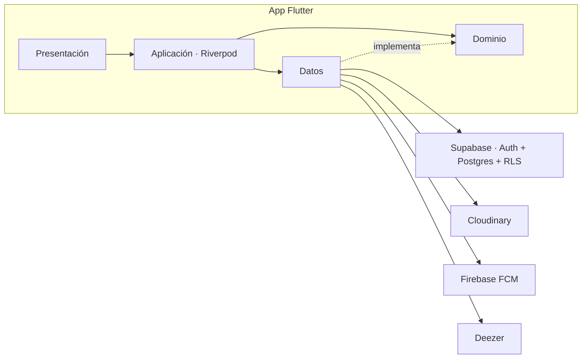
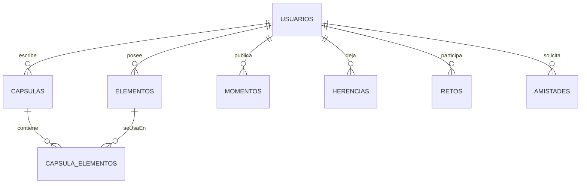

# Capsoul

App Flutter de **cápsulas del tiempo** y **legado digital** para Android e iOS.

**Pequeñas herencias, grandes recuerdos.**

| | |
|---|---|
| **Autor** | Deiby Ramírez |
| **Paquete** | `com.capsoul` · Dart: `capsoul` |
| **Repo** | https://github.com/DeibyRamirez/Capsoul |
| **Ramas** | `main` (estable) · `develop` (integración) |
| **Versión** | 1.0.0+1 |

Capsoul guarda fotos, videos, audios, notas y música, y los entrega en el tiempo: recuerdos privados, cápsulas selladas, momentos con el círculo cercano, herencias digitales y retos entre amigos. El inicio no es un feed público: es la cúpula de vidrio y las cuatro puertas del producto.

## Objetivos

1. **Preservar** recuerdos multimedia de forma privada y segura.
2. **Programar** cápsulas que se abren en una fecha futura para quien elijas.
3. **Dejar legado** con herencias activadas por fecha, inactividad o una persona de confianza.
4. **Compartir** momentos con amistades (red reservada, no Instagram).
5. **Recordar** con retos periódicos entre amigos.

## Usos

| Uso | Qué hace la persona |
|---|---|
| **Recuerdos** | Guarda foto, video, audio, nota o canción en su banco. |
| **Cápsulas** | Sella recuerdos para abrirlos en una fecha, para sí o para un amigo. |
| **Momentos** | Agrupa recuerdos en una historia y la comparte con cercanos. |
| **Mi legado** | Prepara herencias y elige a una persona de confianza. |
| **Retos** | Completa retos diarios, semanales o especiales. |
| **Música** | Busca en Deezer un preview de 30 s y lo une a un recuerdo. |

## Metas

| Meta | Estado |
|---|---|
| Auth con Supabase (correo confirmado) | Hecho |
| Banco de recuerdos y subida a Cloudinary | Hecho |
| Momentos, perfil y amistades | Hecho |
| Cápsulas: crear, listar, detalle con candado | Hecho |
| Legado, persona de confianza y retos | Hecho |
| Música Deezer (búsqueda y preview) | Hecho |
| Avisos push (FCM) y correo (Resend) | En curso |
| Builds Android/iOS en GitHub Actions | Hecho |

## Tecnologías y herramientas

| Pieza | Tecnología | Para qué |
|---|---|---|
| App | Flutter / Dart 3.13 | Android e iOS |
| Estado y rutas | Riverpod, go_router | Inyección y navegación |
| Backend | Supabase (Auth, Postgres, RLS, RPC, Edge Functions, pg_cron) | Cuentas y datos |
| Medios | Cloudinary (`authenticated`) | Foto, video, audio |
| Push | Firebase Cloud Messaging (solo FCM) | Avisos al teléfono |
| Correo | Resend (SMTP) | Confirmación y avisos |
| Música | API pública de Deezer | Catálogo y clip de 30 s |
| CI | GitHub Actions | `flutter analyze`, tests, APK debug |
| Release | Workflow *Build Capsoul* | APK/AAB e IPA al hacer push a `main` |

Detalle de versiones: [Manual técnico](docs/manuales/Manual_Tecnico_Capsoul.md).

## Arquitectura



Capas por funcionalidad en `lib/funcionalidades/<area>/` (`presentacion`, `aplicacion`, `dominio`, `datos`). El cliente solo usa la clave anon de Supabase; las firmas de Cloudinary y los avisos viven en Edge Functions.

## Base de datos

Postgres en Supabase. `elementos` es la tabla central de medios (guarda el `public_id` de Cloudinary, nunca el archivo). Cápsulas, momentos, herencias y retos la consumen. RLS en todas las tablas.



Modelo completo: [`docs/modelo_er.md`](docs/modelo_er.md). Migraciones: [`supabase/migrations/`](supabase/migrations/).

## Manuales

| Documento | Público |
|---|---|
| [Manual técnico](docs/manuales/Manual_Tecnico_Capsoul.md) ([Word](docs/manuales/Manual_Tecnico_Capsoul.docx)) | Quien instala, compila o extiende el código |
| [Manual de usuario](docs/manuales/Manual_Usuario_Capsoul.md) ([Word](docs/manuales/Manual_Usuario_Capsoul.docx)) | Quien usa la app en el teléfono |
| [Índice técnico](docs/README.md) | Visión, flujos, integraciones y convenciones |

## Desarrollo local

1. Copiar `env/dev.json.example` → `env/dev.json` (no commitear). Pegar `SUPABASE_URL` y la clave **anon**.
2. `flutter pub get`
3. `flutter run --dart-define-from-file=env/dev.json`

Antes de probar legado, retos o música en un entorno remoto, aplicar las migraciones del repo (ver [`docs/migraciones.md`](docs/migraciones.md)).

```bash
flutter analyze
flutter test
```

Estado vivo del código: [`Memory.md`](Memory.md).

Nunca pongas `service_role`, `sb_secret_` ni el API secret de Cloudinary en el cliente ni en el repo.
