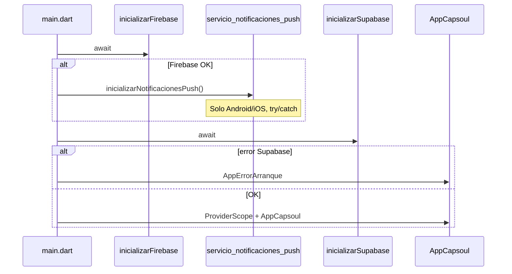
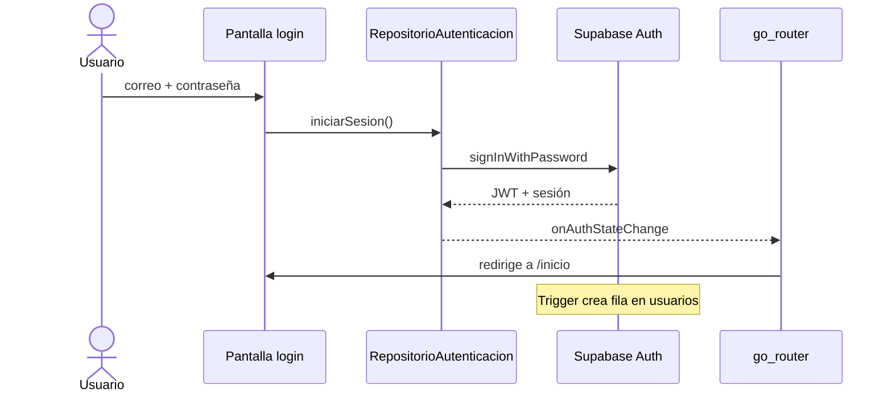
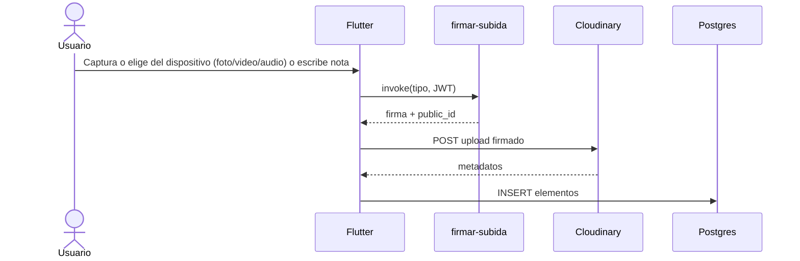
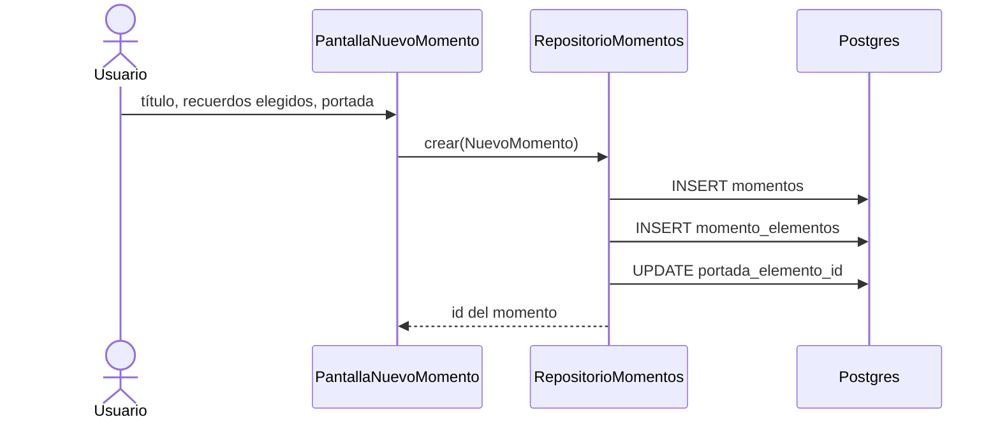

# Capsoul · Flujos críticos

## 0. Mi legado (herencias)

- Creación en wizard → `herencias` + `herencia_elementos` + `herencia_capsulas` (opcional).
- Persona de confianza global: `usuarios.persona_confianza_legado_id` vía `establecer_persona_confianza_legado(@)` (debe ser amigo).
- Liberación: servidor (`activar_herencias`, `confirmar_herencia`, `liberar_herencia`); cápsulas vinculadas pasan a `liberada` con la herencia.
- Contratos: `docs/contrato-api-legado.md`, migración `20261016000014_capsoul_legado_vinculos.sql`.

## 1. Arranque de la app

**Archivos:** `lib/main.dart`, `lib/nucleo/firebase/`, `lib/nucleo/supabase/arranque_supabase.dart`

## 2. Autenticación y sesión

- Sin sesión → rutas de auth (`/iniciar-sesion`, `/registro`, …).
- Con sesión → shell principal (`/inicio`, …).
- **Archivos:** `funcionalidades/autenticacion/`, `nucleo/enrutador/enrutador_app.dart`

## 3. Subida de un medio (recuerdo)

**Origen del archivo:** hoja «Capturar» vs «Elegir del dispositivo» (`hoja_origen_medio.dart`, `importador_medios_dispositivo.dart`); permisos en [10-permisos-dispositivo-y-privacidad.md](10-permisos-dispositivo-y-privacidad.md).

**Archivos:** `funcionalidades/elementos/`, `funcionalidades/recuerdos/`, `supabase/functions/firmar-subida/`

## 4. Crear y programar una cápsula (autor)

1. El autor elige recuerdos del banco o captura nuevos, título, mensaje y **fecha de apertura** futura.
2. Elige **uno o más destinatarios** entre amigos aceptados (`mis_amigos` / selector en crear y editar cápsula). Puede incluirse a sí mismo con «También para mí». No hay búsqueda global de usuarios.
3. El cliente inserta la cápsula en `borrador`, enlaza `capsula_elementos`, inserta filas en `capsula_destinatarios` con **`usuario_id`** (amigo aceptado, o el propio autor desde la migración `20261026000016`) y pasa a `programada`. La fecha de apertura incluye **día y hora** (hora local).
4. El feed tiene tres pestañas sin repetir la misma cápsula: **Mis cápsulas** (enviadas a otros, o todavía sin destinatario), **Para mí mismo** (el autor es el único destinatario) y **Para mí** (las envió otra persona, vía `capsulas_recibidas()`).
5. La tarjeta usa `estado_capsula`. «Lista para abrir» solo aparece cuando el estado es `liberada`. Si la fecha ya pasó y sigue `programada`, se muestra «Aún no liberada» hasta que corra `liberar_capsulas_vencidas()`.

**Archivos:** `funcionalidades/capsulas/`, `funcionalidades/amistades/`, migración `20261009000009_capsoul_amistad_compartir.sql`.

## 4.1. Apertura de cápsula (destinatario)

1. `rpc capsulas_recibidas()` — feed (metadatos también en `programada`; contenido completo tras liberar).
2. Tras `fecha_apertura`, el servidor pasa a `liberada` con `privado.liberar_capsulas_vencidas()` (requiere cron **000002** en remoto; ver [migraciones.md](migraciones.md)).
3. `select` cápsula + elementos (RLS: destinatario en `programada` o `liberada`).
4. `firmar-medio` → URL temporal → reproducción.
5. `rpc marcar_capsula_abierta(id)`.

Ver diagrama completo en [arquitectura.md](arquitectura.md) sección 4.

## 4.2. Amistades por @ (red privada)

1. Cada cuenta tiene `usuarios.nombre_usuario` único (obligatorio en registro o en `/elegir-usuario` si faltaba).
2. En **Amigos**, búsqueda **exacta** por `@` → `resolver_usuario_por_arroba` → `enviar_solicitud_amistad` (estado `pendiente`).
3. El receptor acepta o rechaza en la misma pantalla; solo con amistad **aceptada** el autor elige destinatario en crear cápsula (lista filtrable por `@`).

**Archivos:** migración `000010`, `pantalla_amigos.dart`, `pantalla_elegir_nombre_usuario.dart`.

Enlaces `capsoul://amistad/{token}` (migración `000009`) quedan como compatibilidad; el flujo principal es por @.

## 4.3. Enlaces de app (fase 1 — desarrollo)

| Enlace | Uso |
|--------|-----|
| `capsoul://capsula/{id}` | Navegación si el usuario **ya** es destinatario (no concede acceso). |
| `capsoul://amistad/{token}` | Traer usuarios nuevos a la red del autor. |
| `capsoul://auth/*` | Supabase Auth (PKCE); no lo maneja `EscuchaEnlacesApp`. |

Sin sesión, el enlace se guarda en cola (`proveedorEnlacePendiente`) y se consume tras login.

**Archivos:** `lib/nucleo/enlaces/escucha_enlaces_app.dart`, `enlace_capsoul.dart`, intent-filters Android.

Fase 2 (HTTPS, Universal/App Links, landing de descarga): ver [enlaces-app-fase2.md](enlaces-app-fase2.md).

## 5. Crear un momento

**Archivos:** `funcionalidades/momentos/`, tabla `momentos` + `momento_elementos`

## 6. Perfil vs pestaña Momentos (UI)

| Pantalla | Comportamiento |
|---|---|
| **Yo (Perfil)** | Cabecera Instagram + destacados + búsqueda/filtros + rejilla 2 columnas de momentos |
| **Momentos** | Feed vertical: cada tarjeta = un momento con carrusel horizontal de recuerdos |

Ambas leen `proveedorMomentos`; el filtro en memoria (`proveedorFiltroMomentos`) solo aplica en Perfil.

## 7. Música (Spotify, elemento `musica`)

1. La app invoca la Edge Function `buscar-musica` (JWT del usuario).
2. El servidor obtiene un token Spotify (Client Credentials) y devuelve metadatos + `previewUrl` (fallback Deezer en servidor si falta preview).
3. El usuario guarda un recuerdo `musica` o adjunta la pista a una `foto` (columnas `musica_*` en `elementos`, `musica_preview_proveedor` migración `000015`).
4. Reproducción: `just_audio` con cabeceras CDN → si falla, descarga HTTP temporal → si sigue fallando, `refrescarPreview` vía `buscar-musica` y opcional `actualizarMusicaPreview` en visor propio.
5. “Escuchar completa” abre Spotify, Deezer, YouTube Music o YouTube (`url_launcher`; `queries` en Android).

**Licencias y producción:** [08-musica-producto-y-licencias.md](08-musica-producto-y-licencias.md).

**Archivos:** `funcionalidades/musica/aplicacion/`, `escena_preview_musica.dart`, `supabase/functions/buscar-musica/`

## 8. Retos globales

1. `RepositorioRetosSupabase` lista retos (incl. globales con `propietario_id` null).
2. El usuario marca progreso → `reto_participantes` (enum `completado`).
3. UI: `pantalla_retos.dart` con filtros diario / semanal / especial.

**Archivos:** `funcionalidades/retos/`, migraciones `000011`–`000012`, [`11-legado-y-retos.md`](11-legado-y-retos.md).

## 9. Visor de recuerdo y edición

1. Desde el banco, tap en miniatura → `navegacion_visor_recuerdo` abre `VisorPublicacionRecuerdo` (modal).
2. Música: `EscenaPreviewMusica` con `GlobalKey` para `pausarPreview` al cerrar.
3. Propietario: menú editar / borrar (`acciones_recuerdo.dart`, `pantalla_editar_recuerdo.dart`).

## 10. Importar medio desde el dispositivo

1. Hoja `hoja_origen_medio`: capturar vs elegir de galería/archivos.
2. `importador_medios_dispositivo` + compresión → mismo flujo `firmar-subida` que captura en cámara.
3. Permisos: [10-permisos-dispositivo-y-privacidad.md](10-permisos-dispositivo-y-privacidad.md).
