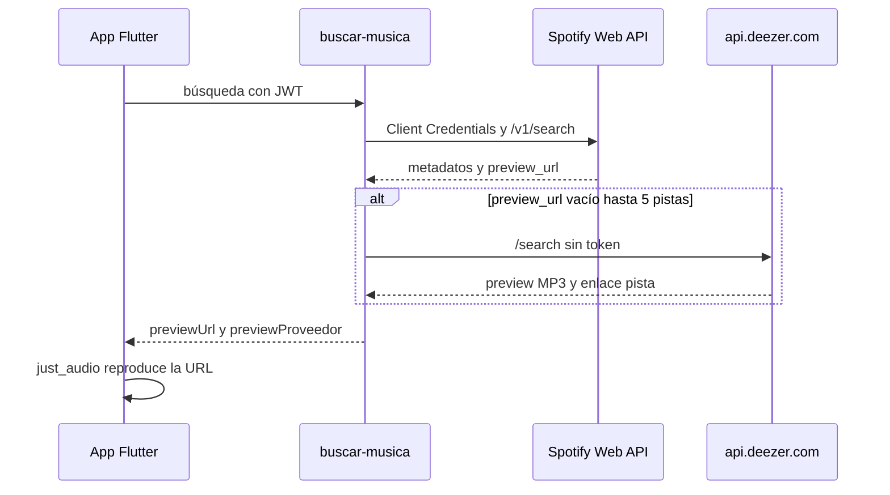

# Capsoul · Música en la app (producto y licencias)

Documento para el **dueño del proyecto** y producto. Detalle técnico de integración en [06-integraciones.md](06-integraciones.md); flujo en app en [04-flujos-criticos.md](04-flujos-criticos.md) §7.

## Qué hace Capsoul con la música

- El usuario puede **asociar una canción** a un recuerdo o cápsula (elemento `musica`): título, artista, portada y enlace al catálogo.
- Dentro de la app solo se reproduce un **preview de ~30 segundos** (si hay URL disponible).
- La **pista completa** no se reproduce en Capsoul: el usuario abre **Spotify**, **Deezer** o una **búsqueda en YouTube** en apps o navegador externos.

La música es un **detalle del recuerdo**, no un reproductor independiente ni un catálogo público.

## Cómo funciona por dentro (resumen)

- **Catálogo y búsqueda:** siempre **Spotify** (IDs y enlaces guardados como `musica_proveedor = spotify`).
- **Preview de 30 s:** primero Spotify (`preview_url`); si falta, **fallback Deezer** en servidor (máx. 5 pistas por búsqueda).
- Los secretos de Spotify **solo** están en Supabase (`buscar-musica`), no en la app.

## Spotify

| Pregunta | Respuesta |
|----------|-----------|
| ¿Los usuarios necesitan Premium? | **No** para buscar ni oír el preview en la app. |
| ¿La app usa la cuenta Premium del usuario? | **No.** Usa credenciales de **aplicación** en el servidor. |
| ¿Para qué sirve Premium del dueño de la app? | En **modo desarrollo** del [Dashboard de Spotify](https://developer.spotify.com/dashboard), el dueño de la app suele necesitar Premium; si no, la búsqueda puede devolver **403**. |
| ¿Premium basta para lanzar con planes de pago? | **No.** Hace falta pasar a **extended quota mode** / revisión y cumplir [políticas de desarrollador](https://developer.spotify.com/documentation/web-api/concepts/quota-modes). |
| Política de previews | Los clips no deben ofrecerse como **servicio o producto standalone** ([`preview_url`](https://developer.spotify.com/documentation/web-api/reference/search)). En Capsoul van dentro de un recuerdo/cápsula y la escucha completa es externa. |

**Recomendación:** iniciar trámite de cuota extendida cuando exista entidad legal y app en beta cerrada; no asumir que el pago mensual de Premium sustituye ese proceso.

## Deezer

- Solo se usa como **respaldo técnico** cuando Spotify no devuelve preview.
- La API pública gratuita está limitada a uso **no comercial** ([términos de desarrolladores](https://developers.deezer.com/termsofuse)).
- Una app **comercial** (suscripciones, tiendas) puede requerir acuerdo con [Deezer for Partners](https://support.deezer.business/).

**Recomendación por fases:**

| Fase | Acción |
|------|--------|
| Desarrollo / beta cerrada | Se puede mantener el fallback con conocimiento del riesgo; documentar en release notes internas. |
| Antes de lanzamiento comercial | **Desactivar fallback Deezer** en `buscar-musica` **o** firmar acuerdo con Deezer. |
| Plan B sin acuerdo | Solo previews que Spotify devuelva; si no hay preview, metadatos + «Escuchar en Spotify / YouTube». |

Capsoul **no** usa SDK de Deezer: solo reproduce la URL del preview y abre la pista en la app/web de Deezer.

## Capsoul como red privada de recuerdos y cápsulas

- El uso previsto (recuerdos personales, cápsulas para un destinatario en una fecha) **no es** promocionar productos en redes con música de terceros.
- Aun así, **cobrar planes** convierte la app en producto **comercial** frente a los términos gratuitos de Deezer; Spotify exige **cuota y cumplimiento** propios.
- No usar previews de Spotify/Deezer en **anuncios** o reels de venta (cursos, ropa, etc.).

## Decisiones pendientes (PO)

| # | Decisión | Opciones |
|---|----------|----------|
| 1 | ¿Mantener fallback Deezer en beta pública? | Sí temporalmente / No / Solo con asesoría legal |
| 2 | ¿Fecha objetivo solicitud Spotify extended quota? | Fecha / Aún no |
| 3 | Si no hay preview, ¿UX aceptable? | Solo enlaces externos / Grabación de voz del usuario / Otra |
| 4 | ¿Contactar Deezer for Partners antes del launch? | Sí / No / Tras MVP de cápsulas |

## Referencias

- [06-integraciones.md](06-integraciones.md) — secretos, límites y despliegue de `buscar-musica`.
- [04-flujos-criticos.md](04-flujos-criticos.md) — flujo usuario al buscar y guardar música.
- Migración `20261005000005_capsoul_musica.sql` y `20261006000006_capsoul_musica_enlace_deezer.sql`.
