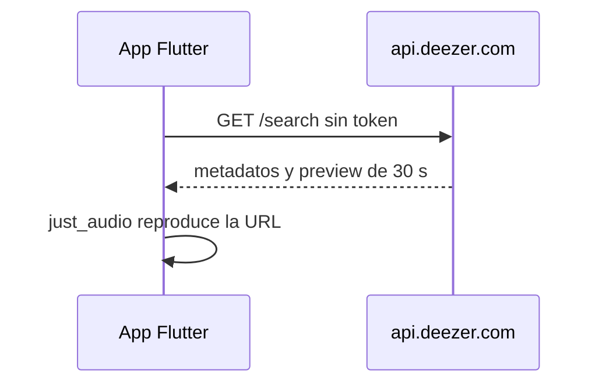

# Capsoul · Música en la app (producto y licencias)

Documento para el **dueño del proyecto** y producto. Detalle técnico de integración en [06-integraciones.md](06-integraciones.md); flujo en app en [04-flujos-criticos.md](04-flujos-criticos.md) §7.

## Qué hace Capsoul con la música

- El usuario puede **asociar una canción** a un recuerdo o cápsula (elemento `musica`): título, artista, portada y enlace al catálogo.
- Dentro de la app solo se reproduce un **preview de ~30 segundos** (si hay URL disponible).
- La **pista completa** no se reproduce en Capsoul: el usuario abre **Spotify**, **Deezer** o una **búsqueda en YouTube** en apps o navegador externos.

La música es un **detalle del recuerdo**, no un reproductor independiente ni un catálogo público.

## Cómo funciona por dentro (resumen)

- **Catálogo y búsqueda:** API pública de **Deezer** (`musica_proveedor = deezer`). La app llama a `api.deezer.com` directo.
- **Preview de 30 s:** URL de Deezer. Caduca y no se guarda; al reproducir se vuelve a pedir `/track/<id>`.
- `buscar-musica` hace la misma búsqueda (JWT, máximo 10, `proveedor: deezer`) y **no** la usa la app. No hay secretos de catálogo.
- **Spotify** queda para el botón «Buscar en Spotify» (enlace externo) y para recuerdos ya guardados con ese proveedor.

## Spotify (enlaces y recuerdos antiguos)

| Pregunta | Respuesta |
|----------|-----------|
| ¿Los usuarios necesitan Premium? | **No** para buscar ni oír el preview en la app (eso sale de Deezer). |
| ¿La app usa la Web API o credenciales de Spotify? | **No.** El botón abre `open.spotify.com` o el enlace ya guardado. |
| ¿Qué pasa con un recuerdo antiguo de Spotify? | Se sigue leyendo y se abre en Spotify. El preview, si hacía falta refrescarlo, se busca en Deezer. |

## Deezer

- Es el **catálogo** de la búsqueda y del preview de 30 s (app y Edge Function `buscar-musica`).
- La API pública gratuita está limitada a uso **no comercial** ([términos de desarrolladores](https://developers.deezer.com/termsofuse)).
- Una app **comercial** (suscripciones, tiendas) puede requerir acuerdo con [Deezer for Partners](https://support.deezer.business/).

**Recomendación por fases:**

| Fase | Acción |
|------|--------|
| Desarrollo / beta cerrada | Se puede usar la API pública con conocimiento del riesgo; la UI ya avisa de uso personal. |
| Antes de lanzamiento comercial | Firmar acuerdo con Deezer **o** dejar de reproducir previews en la app. |
| Plan B sin acuerdo | Metadatos + «Abrir en Deezer / buscar en Spotify / YouTube», sin clip de 30 s. |

Capsoul **no** usa SDK de Deezer: solo reproduce la URL del preview y abre la pista en la app/web de Deezer.

## Capsoul como red privada de recuerdos y cápsulas

- El uso previsto (recuerdos personales, cápsulas para un destinatario en una fecha) **no es** promocionar productos en redes con música de terceros.
- Aun así, **cobrar planes** convierte la app en producto **comercial** frente a los términos gratuitos de Deezer.
- No usar previews de Deezer (ni clips antiguos de Spotify) en **anuncios** o reels de venta (cursos, ropa, etc.).

## Decisiones pendientes (PO)

| # | Decisión | Opciones |
|---|----------|----------|
| 1 | ¿Seguir con la API pública de Deezer en beta? | Sí, con el aviso de uso personal / Solo con asesoría legal |
| 2 | Si no hay preview, ¿UX aceptable? | Solo enlaces externos / Grabación de voz del usuario / Otra |
| 3 | ¿Contactar Deezer for Partners antes del launch? | Sí / No / Tras MVP de cápsulas |

## Referencias

- [06-integraciones.md](06-integraciones.md) — Deezer, límite de `buscar-musica` y enlaces de Spotify.
- [04-flujos-criticos.md](04-flujos-criticos.md) — flujo usuario al buscar y guardar música.
- Migración `20261005000005_capsoul_musica.sql` y `20261006000006_capsoul_musica_enlace_deezer.sql`.
