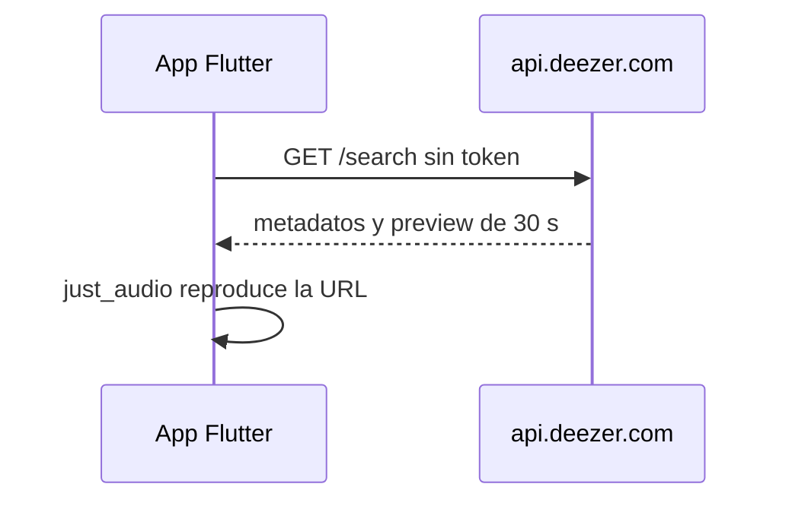

# Capsoul · Música en la app (producto y licencias)

Documento para el **dueño del proyecto** y producto. Detalle técnico de integración en [06-integraciones.md](06-integraciones.md); flujo en app en [04-flujos-criticos.md](04-flujos-criticos.md) §7.

## Qué hace Capsoul con la música

- El usuario puede **asociar una canción** a un recuerdo o cápsula (elemento `musica`): título, artista, portada y enlace al catálogo.
- Dentro de la app solo se reproduce un **preview de ~30 segundos** (si hay URL disponible).
- La **pista completa** no se reproduce en Capsoul: el usuario abre **Spotify**, **Deezer** o una **búsqueda en YouTube** en apps o navegador externos.

La música es un **detalle del recuerdo**, no un reproductor independiente ni un catálogo público.

## Cómo funciona por dentro (resumen)



- **Catálogo y búsqueda:** API pública de **Deezer** (`musica_proveedor = deezer`). La app llama a `api.deezer.com` directo.
- **Preview de 30 s:** URL de Deezer. Caduca y no se guarda; al reproducir se vuelve a pedir `/track/<id>`.
- `buscar-musica` hace la misma búsqueda (JWT, máximo 10, `proveedor: deezer`) y **no** la usa la app. No hay secretos de catálogo.
- **Spotify** queda para el botón «Buscar en Spotify» (enlace externo) y para recuerdos ya guardados con ese proveedor.

## Spotify (enlaces y recuerdos antiguos)

| Pregunta | Respuesta |
|----------|-----------|
| ¿Los usuarios necesitan Premium? | **No** para buscar ni oír el preview en la app (eso sale de Deezer). |
| ¿La app usa la Web API o credenciales de Spotify? | **No.** El botón abre `open.spotify.com` o el enlace ya guardado. |
| ¿Qué pasa con un recuerdo antiguo de Spotify? | Se sigue leyendo y se abre en Spotify. El preview, si hacía falta refrescarlo, se busca en Deezer. |

## Deezer

- Es el **catálogo** de la búsqueda y del preview de 30 s (app y Edge Function `buscar-musica`).
- La API pública gratuita está limitada a uso **no comercial** ([términos de desarrolladores](https://developers.deezer.com/termsofuse)).
- Una app **comercial** (suscripciones, tiendas) puede requerir acuerdo con [Deezer for Partners](https://support.deezer.business/).

**Recomendación por fases:**

| Fase | Acción |
|------|--------|
| Desarrollo / beta cerrada | Se puede usar la API pública con conocimiento del riesgo; la UI ya avisa de uso personal. |
| Antes de lanzamiento comercial | Firmar acuerdo con Deezer **o** dejar de reproducir previews en la app. |
| Plan B sin acuerdo | Metadatos + «Abrir en Deezer / buscar en Spotify / YouTube», sin clip de 30 s. |

Capsoul **no** usa SDK de Deezer: solo reproduce la URL del preview y abre la pista en la app/web de Deezer.

## Capsoul como red privada de recuerdos y cápsulas

- El uso previsto (recuerdos personales, cápsulas para un destinatario en una fecha) **no es** promocionar productos en redes con música de terceros.
- Aun así, **cobrar planes** convierte la app en producto **comercial** frente a los términos gratuitos de Deezer.
- No usar previews de Deezer (ni clips antiguos de Spotify) en **anuncios** o reels de venta (cursos, ropa, etc.).

## Incidencias del preview (2026-10-31)

Tres fallos vistos en el Android del PO (Xiaomi 23117RA68G), corregidos en la rama `correccion/preview-musica`:

| # | Síntoma en logs | Causa | Arreglo |
|---|-----------------|-------|---------|
| 1 | `Cleartext HTTP traffic to 127.0.0.1 not permitted` y `(0) Source error` | `AudioSource.uri(..., headers: ...)`: con headers, just_audio levanta un proxy HTTP local en `127.0.0.1` y Android bloquea ese tráfico sin cifrar. | El preview se reproduce directo con `AudioSource.uri(url)`, sin headers, caché ni proxy (sigue en streaming). |
| 2 | `Response code: 403` y luego `FalloRecuerdo(permiso_denegado)` | Las filas antiguas (`musica_proveedor = 'spotify'`, anteriores a la 000023) guardaban la URL firmada de Deezer, que caduca. Al refrescarla, la app intentaba guardarla con `duracion_segundos` y `musica_preview_proveedor`, columnas sin grant de UPDATE para `authenticated`, y Postgres respondía 42501. El 23514 (check) sí se traduce bien a `dato_invalido`. | La URL de Deezer se usa solo en memoria y nunca se persiste (`convienePersistirPreview`). Si la URL guardada es de Deezer se ignora y se pide siempre `/track/<id>` (`debePedirPreviewFresco`). |
| 3 | `Incorrect use of ParentDataWidget` (dos `Positioned`) al abrir una foto con música a pantalla completa | `OverlayMusicaFotoVis` ya devuelve un `Positioned` y el visor lo envolvía en otro. En release se ve un recuadro gris en lugar de la franja de música. | El overlay recibe `margenLateral` y `margenInferior` y va directo en el `Stack`. Además, el autoplay usa `puedeReproducirPreview`, así que también arranca en pistas de Deezer guardadas sin URL. |

Limpieza de datos propuesta (**no aplicada**, requiere aprobación del PO). La app ya ignora estas URL:

```sql
update public.elementos set musica_preview_url = null
where musica_proveedor = 'spotify'
  and musica_enlace_deezer is not null
  and musica_preview_url ilike '%dzcdn%';
```

### Reglas del preview que no se pueden romper

Si un cambio rompe alguna de estas reglas, la música vuelve a fallar en Android. Cada regla tiene un test que la protege; si ese test falla, no se debe hacer merge.

| # | Regla | Por qué | Test que la protege |
|---|-------|---------|---------------------|
| 1 | `AudioSource.uri(url)` **sin headers**, sin `LockCachingAudioSource`, sin `StreamAudioSource` ni ningún proxy. | Con cualquiera de ellos, just_audio abre un proxy `http://127.0.0.1` y Android lo bloquea (cleartext). | `test/funcionalidades/musica/aplicacion/reproducir_preview_musica_test.dart` |
| 2 | **Streaming**: se reproduce la URL https directo con ExoPlayer/AVPlayer; no se descarga ni se guarda el MP3. | Licencia de Deezer (solo preview en streaming) y regla 1. | `test/funcionalidades/musica/aplicacion/reproducir_preview_musica_test.dart` |
| 3 | **Nunca guardar la `preview_url` de Deezer.** Se pide siempre `GET /track/<id>` y la URL se usa solo en memoria. | Es una URL firmada que vence; guardada da 403. | `test/funcionalidades/musica/aplicacion/intentar_cargar_preview_con_refresco_test.dart` (`convienePersistirPreview`), `test/funcionalidades/musica/dominio/referencia_musica_test.dart` (`aFilaBd`), `test/funcionalidades/musica/aplicacion/refrescar_preview_musica_test.dart` |
| 4 | Filas antiguas de Spotify con URL `dzcdn` guardada: **se ignora esa URL** y se pide `/track/<id>` con el id sacado de `musica_enlace_deezer`. | Esas URL ya vencieron (403). | `test/funcionalidades/musica/aplicacion/intentar_cargar_preview_con_refresco_test.dart` (`debePedirPreviewFresco`), `test/funcionalidades/musica/aplicacion/refrescar_preview_musica_test.dart` |
| 5 | El UPDATE de música **no envía `duracion_segundos` ni `musica_preview_proveedor`**: solo columnas con grant de UPDATE para `authenticated`. | Sin grant de columna, Postgres responde 42501 y la app muestra `permiso_denegado`. | `test/funcionalidades/recuerdos/datos/repositorio_recuerdos_supabase_test.dart` (`actualizarMusicaPreview no envia columnas sin grant...`) |
| 6 | Respetar el check `elementos_musica_deezer_coherente` de la migración **000023**: si `musica_proveedor = 'deezer'`, el id es numérico y `musica_preview_url` es null. Un 23514 se muestra como `dato_invalido`, no como `permiso_denegado`. | Lo exige la base de datos; un mapeo incorrecto confunde el diagnóstico. | `test/funcionalidades/musica/dominio/referencia_musica_test.dart`, `test/funcionalidades/recuerdos/datos/repositorio_recuerdos_supabase_test.dart` (23514 → `datoInvalido`) |
| 7 | `OverlayMusicaFotoVis` ya es un `Positioned`: va directo en el `Stack`, sin envolverlo en otro `Positioned`. | Si se envuelve, sale `Incorrect use of ParentDataWidget` y la franja de música no se ve. | `test/funcionalidades/musica/presentacion/componentes/overlay_musica_foto_vis_test.dart` |

Archivos clave: `lib/funcionalidades/musica/aplicacion/reproducir_preview_musica.dart`, `intentar_cargar_preview_con_refresco.dart`, `refrescar_preview_musica.dart`, `lib/funcionalidades/musica/dominio/referencia_musica.dart` (`aFilaBd`) y `lib/funcionalidades/recuerdos/datos/repositorio_recuerdos_supabase.dart` (`cambiosMusicaPreview`).

## Decisiones pendientes (PO)

| # | Decisión | Opciones |
|---|----------|----------|
| 1 | ¿Seguir con la API pública de Deezer en beta? | Sí, con el aviso de uso personal / Solo con asesoría legal |
| 2 | Si no hay preview, ¿UX aceptable? | Solo enlaces externos / Grabación de voz del usuario / Otra |
| 3 | ¿Contactar Deezer for Partners antes del launch? | Sí / No / Tras MVP de cápsulas |

## Referencias

- [06-integraciones.md](06-integraciones.md) — Deezer, límite de `buscar-musica` y enlaces de Spotify.
- [04-flujos-criticos.md](04-flujos-criticos.md) — flujo usuario al buscar y guardar música.
- Migración `20261005000005_capsoul_musica.sql` y `20261006000006_capsoul_musica_enlace_deezer.sql`.
