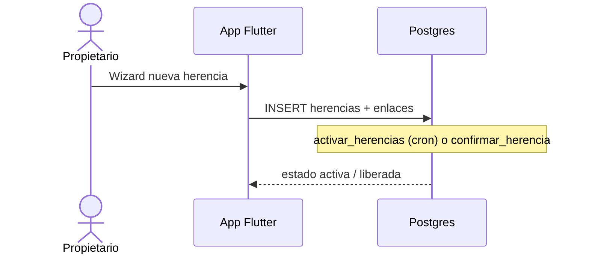

# Capsoul · Legado digital y retos

> Complemento de [`modelo_er.md`](modelo_er.md) · 2026-10-16

## Legado (herencias)

### Tablas principales

| Tabla | Rol |
|-------|-----|
| `herencias` | Acto de legado: autor, estado, fecha de activación, persona de confianza |
| `herencia_elementos` | Recuerdos incluidos en la herencia |
| `herencia_capsulas` | Cápsulas vinculadas (se liberan con la herencia) |
| `usuarios.persona_confianza_legado_id` | Amigo global que puede confirmar |

### Flujo resumido

Contrato HTTP/RPC: [`contrato-api-legado.md`](contrato-api-legado.md) · SQL: migración `20261016000014`.

**Código:** `lib/funcionalidades/legado/` · pantallas `pantalla_nueva_herencia`, `pantalla_legado`, `pantalla_seguridad_legado`.

## Retos globales

### Tablas

| Tabla | Rol |
|-------|-----|
| `retos` | Catálogo (diario, semanal, especial); puede ser global (`propietario_id` null) |
| `reto_participantes` | Progreso por usuario; enum `completado` |

Migraciones: `20261011000011` (enum), `20261011000012` (semillas y RLS).

**Código:** `lib/funcionalidades/retos/presentacion/pantalla_retos.dart` · contrato JSON: [`contrato-retos.json`](contrato-retos.json).

## Pruebas SQL

- Retos: [`supabase/pruebas/pruebas_retos_globales.sql`](../supabase/pruebas/pruebas_retos_globales.sql)
- Legado: ver comentarios en migración `000014`
