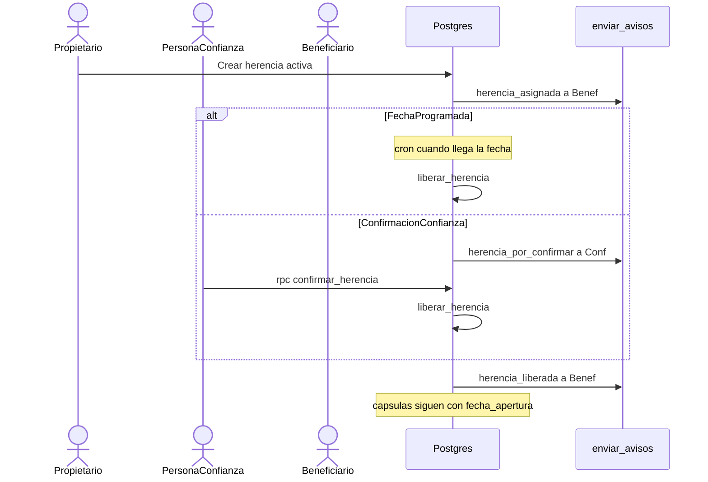
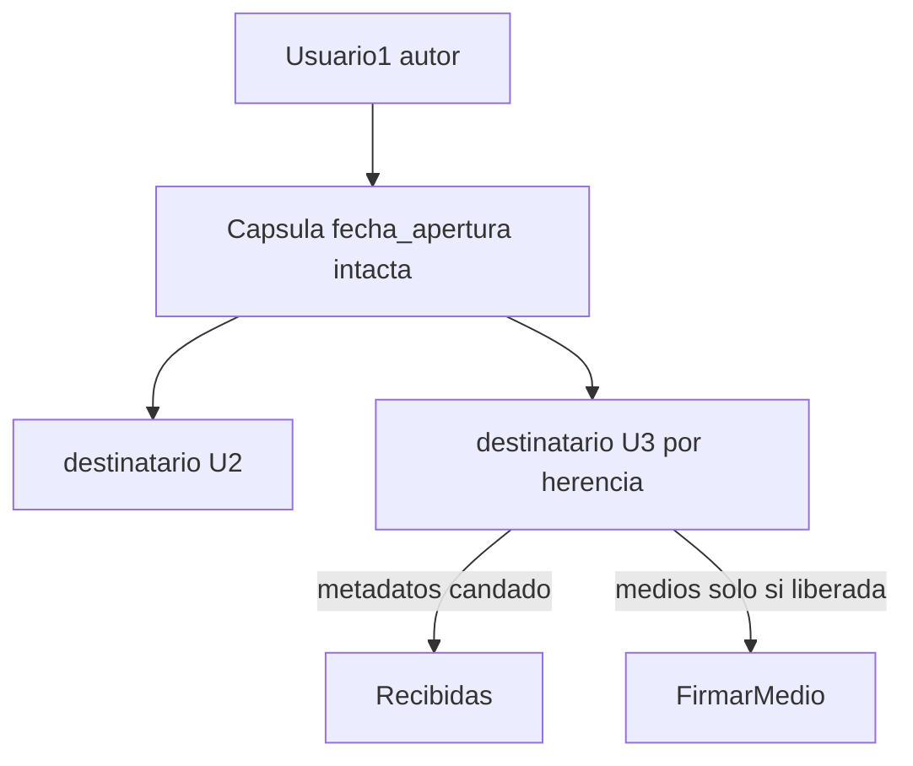

# Capsoul · Legado digital y retos

> Complemento de [`modelo_er.md`](modelo_er.md) · 2026-11-02

## Legado (herencias)

### Tablas principales

| Tabla | Rol |
|-------|-----|
| `herencias` | Acto de legado: autor, estado, fecha de activación, persona de confianza |
| `herencia_elementos` | Recuerdos incluidos en la herencia (solo si `liberada`) |
| `herencia_capsulas` | Cápsulas vinculadas. **No** se abren al activar la herencia |
| `capsula_destinatarios.origen_herencia_id` | Destinatario añadido porque la cápsula está en esa herencia |
| `usuarios.persona_confianza_legado_id` | Amigo global que puede confirmar |

### Activación (solo dos caminos en la app)

- **Fecha programada:** el cron `activar_herencias` libera cuando `fecha_activacion <= now()`.
- **Confirmación de persona de confianza:** un amigo distinto del beneficiario pulsa Confirmar (`rpc confirmar_herencia`). No es un certificado legal: es una llave humana. No ve valor ni medios sellados.

La inactividad sigue en el enum de Postgres por filas antiguas; el wizard ya no la ofrece.

### Cápsulas dentro de una herencia

U1 crea una cápsula para U2. Luego crea una herencia para U3 y vincula esa cápsula. U3 entra en `capsula_destinatarios` con `origen_herencia_id`. U2 no pierde su fila. El contenido del medio exige cápsula `liberada` (cron de `fecha_apertura`).

Quién ve qué:

- **Propietario:** siempre su herencia y sus medios.
- **Beneficiario:** sabe que llegó (`herencias_recibidas`) desde el alta; contenido solo si `liberada`.
- **Persona de confianza:** lista `herencias_por_confirmar` sin metadatos sensibles.
- **Cápsulas:** acceso = lista de `usuario_id` en `capsula_destinatarios`.

Contrato HTTP/RPC: [`contrato-api-legado.md`](contrato-api-legado.md) · SQL: `20261016000014` + `20261102000024` + `20261102000025`.

**Código:** `lib/funcionalidades/legado/` · pantallas `pantalla_nueva_herencia`, `pantalla_legado` (Creadas / Recibidas), `pantalla_editar_herencia`, `pantalla_seguridad_legado`.

## Retos globales

### Tablas

| Tabla | Rol |
|-------|-----|
| `retos` | Catálogo (diario, semanal, especial); puede ser global (`creador_id` null) |
| `reto_participantes` | Progreso por usuario; enum `completado` |

Migraciones: `20261011000011` (enum), `20261011000012` (semillas y RLS).

**Código:** `lib/funcionalidades/retos/presentacion/pantalla_retos.dart` · contrato JSON: [`contrato-retos.json`](contrato-retos.json).

## Pruebas SQL

- Retos: [`supabase/pruebas/pruebas_retos_globales.sql`](../supabase/pruebas/pruebas_retos_globales.sql)
- Legado permisos: [`supabase/pruebas/pruebas_herencias_permisos.sql`](../supabase/pruebas/pruebas_herencias_permisos.sql)
