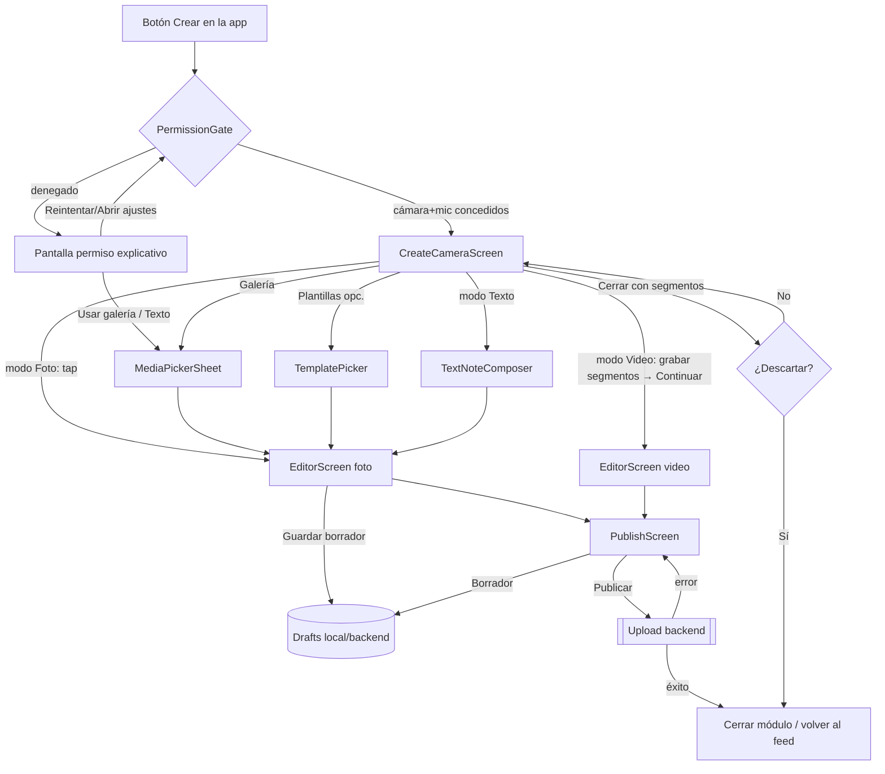
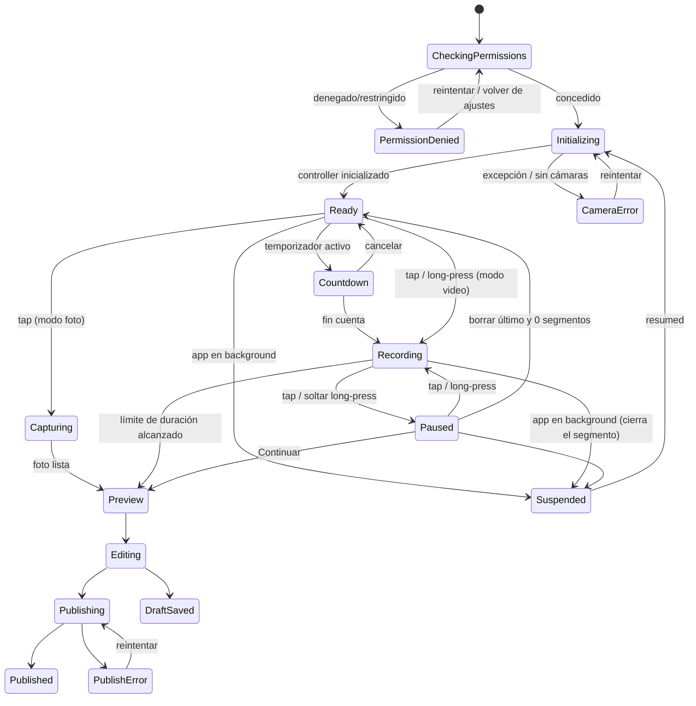

# Módulo «Crear» — Documentación de diseño frontend (Flutter)

> **Estado:** propuesta de diseño, versión 1.0 (9 nov 2026, hora de Bogotá).
> **Referencia:** patrones de interacción del flujo «Crear» de TikTok, documentados en su centro de ayuda público (ver [Fuentes](#18-fuentes)).
> **No se copia** la marca, los logos, los colores, los iconos propietarios ni los textos de TikTok. Todos los tokens de marca son **placeholders configurables**.
> **Convención:** el texto está en español y el código, los nombres y los tokens en inglés. **(estimado)** marca lo que no está verificado o es una recomendación de diseño sin fuente.
> El proyecto destino (nombre, marca y backend) es desconocido. Todo lo que depende del backend está marcado **[backend]**.

---

## Índice
1. [Objetivo y alcance](#1-objetivo-y-alcance)
2. [Patrones de referencia verificados](#2-patrones-de-referencia-verificados)
3. [Flujo de usuario y máquina de estados](#3-flujo-de-usuario-y-máquina-de-estados)
4. [Anatomía de pantallas](#4-anatomía-de-pantallas)
5. [Arquitectura Flutter (feature-first)](#5-arquitectura-flutter-feature-first)
6. [Catálogo de widgets y API sugerida](#6-catálogo-de-widgets-y-api-sugerida)
7. [Gestión de estado](#7-gestión-de-estado)
8. [Paquetes sugeridos (verificados en pub.dev)](#8-paquetes-sugeridos-verificados-en-pubdev)
9. [Design tokens](#9-design-tokens)
10. [Gestos y microinteracciones](#10-gestos-y-microinteracciones)
11. [Accesibilidad (WCAG 2.1 AA)](#11-accesibilidad-wcag-21-aa)
12. [Rendimiento y ciclo de vida](#12-rendimiento-y-ciclo-de-vida)
13. [Permisos Android / iOS](#13-permisos-android--ios)
14. [Estados vacío, cargando y error](#14-estados-vacío-cargando-y-error)
15. [Snippets Dart (esqueleto)](#15-snippets-dart-esqueleto)
16. [Orden de implementación por fases](#16-orden-de-implementación-por-fases)
17. [Checklist de criterios de aceptación](#17-checklist-de-criterios-de-aceptación)
18. [Fuentes](#18-fuentes)
19. [Limitaciones y decisiones abiertas](#19-limitaciones-y-decisiones-abiertas)

Wireframes conceptuales (en `wireframes/`):

| Archivo | Pantalla |
|---|---|
| `01-camara-foto-video.png` | Cámara con barra de modos, rail de herramientas, disparador y selector de duración |
| `02-editor-preview.png` | Editor/preview con herramientas, overlays y papelera |
| `03-nota-texto.png` | Nota de texto (fondo, tipografía, alineación) |
| `04-publicar.png` | Publicar (descripción, portada, privacidad) — depende del backend |

---

## 1. Objetivo y alcance

**Objetivo.** Al pulsar «Crear» se abre un módulo a pantalla completa. Su punto de entrada es la cámara y desde ahí el usuario produce, con el menor número de pasos, uno de estos contenidos:

- **Foto:** un toque en el disparador.
- **Video:** toque para iniciar/detener, o mantener pulsado para grabar. Admite varios segmentos y un límite de duración.
- **Nota de texto:** un fondo de color con texto estilizado, sin cámara.
- **Subir desde la galería:** fotos y/o videos del dispositivo.
- **Plantillas (opcional):** layouts predefinidos [backend o assets].

Después pasa por un **editor**, con texto, stickers opcionales, recorte y audio opcional, y llega a **Publicar** o **Guardar borrador**.

**Dentro del alcance (frontend):**
- Pantallas, componentes, estados visuales y navegación.
- Una capa de captura desacoplada, detrás de una interfaz `CaptureService`.
- Permisos, ciclo de vida, accesibilidad, tokens y criterios de aceptación.

**Fuera del alcance:**
- Subida, transcodificación, moderación, almacenamiento y feed.
- Catálogo de sonidos o efectos y AR/filtros faciales en tiempo real.
- Exportación con overlays «quemados» en el video. Esto requiere un proceso nativo o de servidor; ver §19.

**Restricciones de diseño:**
- Solo orientación vertical.
- Animaciones únicamente con `transform` y `opacity`.
- Respetar el movimiento reducido.
- Tamaños táctiles de al menos 48 dp.
- Contraste AA sobre la cámara mediante scrims.

---

## 2. Patrones de referencia verificados

Se tomaron estos patrones del centro de ayuda de TikTok. Se describen con palabras propias y sin reproducir sus textos de interfaz.

| Patrón | Lo que indica la fuente | Uso en este diseño |
|---|---|---|
| Entrada | Un botón «+» en la barra inferior abre la cámara [S1][S4] | El botón «Crear» de la app abre `CreateCameraScreen` a pantalla completa |
| Duración | Se elige una duración máxima antes de grabar. Al llegar a ella la grabación se detiene sola [S2] | `DurationSelector` con valores configurables. Auto-stop al alcanzar el límite |
| Segmentos | Tocar el botón otra vez pausa. El clip queda guardado y se pueden encadenar varios. Se puede borrar el último o continuar [S4] | `SegmentProgressBar`, botón «borrar último segmento» y botón «continuar» |
| Rail derecho | Herramientas como voltear, flash, velocidad, temporizador y filtros [S2][S4] | `CameraToolRail`, con cada herramienta activable por feature flag |
| Temporizador | Cuenta regresiva y luego graba sin mantener pulsado. Se puede marcar el punto de parada [S2] | `CountdownOverlay` y un límite de parada opcional |
| Voltear | Se puede cambiar de cámara incluso grabando [S2] | Voltear durante la grabación queda **(estimado)** según el plugin (§19) |
| Modo Foto + subir | Foto, y subir varias imágenes, hasta 35 según la fuente [S1][S3] | Modo `photo`. El límite de selección es **configurable**; 35 es solo la cifra de la referencia |
| Modo Texto | Escribir texto y ajustar tamaño, estilo, alineación, fuente y color. Luego stickers y color de fondo [S1] | `TextNoteComposer` |
| Editor | Filtro, sonido, texto, stickers, recorte y efectos. Un sticker se elimina arrastrándolo a una zona de borrado [S1][S3] | `EditorScreen` con `EditorToolbar` y una `DeleteZone` al arrastrar |
| Publicar | Descripción, hashtags, etiquetas, ubicación, enlace, privacidad, portada, publicar o borrador [S1][S4] | `PublishScreen`. Casi todo es [backend] |

No se usan las duraciones concretas de TikTok (por ejemplo 15 s o 60 s, que cambian con el tiempo). Las duraciones son **configuración del producto**. En los wireframes aparecen como ejemplo.

---

## 3. Flujo de usuario y máquina de estados

### 3.1 Flujo principal



### 3.2 Estados de la sesión de captura



**Reglas de la máquina de estados:**
- **Duración mínima:** «Continuar» solo se habilita si la duración total es al menos `minDuration`, configurable. El valor por defecto de 1 s es **(estimado)**.
- **Background:** si la app pasa a segundo plano mientras graba, se detiene y se conserva el segmento. Después se libera el controller (§12).
- **Cambio de modo:** está bloqueado mientras se graba o si hay segmentos sin confirmar. En ese caso se muestra «¿Descartar?».

---

## 4. Anatomía de pantallas

Las medidas están en dp lógicos. Los números de zona remiten al wireframe `01`.

### 4.1 `CreateCameraScreen` (Foto / Video) — `wireframes/01-camara-foto-video.png`

| Zona | Contenido | Notas |
|---|---|---|
| **Z0 Fondo** | `CameraPreview` a pantalla completa (cover) | Escalar con `FittedBox(fit: BoxFit.cover)` respetando el aspect ratio del sensor |
| **Z1 Scrim superior** | Gradiente negro → transparente, 0,45 de opacidad aprox. **(estimado)** | Garantiza el contraste AA de los iconos blancos (§9.5) |
| **Z2 Top bar** | Izquierda: `Cerrar` (X). Centro: chip «Añadir sonido» **opcional** | Si el producto no tiene catálogo de audio, el chip se oculta |
| **Z3 Barra de segmentos** | `SegmentProgressBar` en el borde superior, dentro de la safe area | Solo es visible en modo Video. Muestra un separador entre segmentos |
| **Z4 Rail derecho** | `CameraToolRail` en columna: Voltear, Flash, Velocidad*, Temporizador, Filtros*, Retoque* | Los marcados con * son opcionales y van detrás de un feature flag. Cada ítem lleva icono y etiqueta corta |
| **Z5 Selector de duración** | Chips horizontales, por encima del disparador | Solo en modo Video. Se oculta al grabar |
| **Z6 Fila de captura** | Izquierda: `GalleryButton` (miniatura del último medio). Centro: `CaptureButton` con `RecordingProgressRing`. Derecha: «Borrar último segmento» y «Continuar» | Los botones de la derecha solo aparecen cuando hay al menos un segmento |
| **Z7 Selector de modo** | `ModeSelector`: Plantillas*, Foto, Video, Texto | Deslizable y con snap. El modo activo va centrado y subrayado |
| **Z8 Scrim inferior** | Gradiente transparente → negro | Cubre Z5 a Z7 |

**Comportamiento del disparador:**
- **Foto:** un tap captura. Se ve un flash blanco de opacidad 0 → 0,6 → 0 en 150 ms **(estimado)** y se va a Preview.
- **Video, tap:** el primer tap inicia y el siguiente pausa (crea un segmento).
- **Video, long-press:** graba mientras se mantiene pulsado y al soltar se pausa.
- **Durante la grabación:** el botón escala a 1,15 y el centro cambia a un cuadrado redondeado. Solo se usa `transform` en la animación.
- **Límite de duración:** se detiene solo, hay un haptic y se pasa a Preview.

**Al grabar se ocultan** Z2 (salvo el contador), Z4, Z5, Z7 y la galería, con opacidad → 0. Así hay foco y menos toques accidentales. Se muestra un contador `mm:ss` legible.

### 4.2 `EditorScreen` (Preview + edición) — `wireframes/02-editor-preview.png`

| Zona | Contenido | Dependencia |
|---|---|---|
| Fondo | `MediaPreview`: video en bucle o foto (carrusel si son varias) | Local |
| Top bar | Volver (confirma si hay cambios) y chip de Sonido opcional | El sonido es [backend] si viene de un catálogo |
| Rail derecho | `EditorToolbar`: Texto, Stickers*, Recortar, Audio*, Filtros* | Los stickers pueden ser assets locales o un [backend] |
| Lienzo | `OverlayLayer` con `OverlayItem`: arrastrar, y pinch para escalar y rotar | Local |
| Papelera | `DeleteZone` abajo y al centro. Solo aparece mientras se arrastra un overlay | Local |
| Bottom bar | «Guardar borrador» (secundario) y «Siguiente» (primario) | El borrador puede ser local o [backend] |

- **Recortar video:** usa `TrimTimeline` con dos manijas y miniaturas. Para generar las miniaturas hace falta un paquete adicional (§8, opcional).
- **Recortar foto:** encuadre con `InteractiveViewer` más una relación de aspecto fija 9:16.
- **Texto en el editor:** reutiliza `TextStyleBar` de la pantalla Nota.

### 4.3 `TextNoteComposer` (Nota) — `wireframes/03-nota-texto.png`

| Zona | Contenido |
|---|---|
| Top bar | Cerrar y «Listo» (deshabilitado si el texto está vacío) |
| Lienzo | `TextField` multilínea centrado con autoescala de fuente entre `minFontSize` y `maxFontSize`, sobre el fondo elegido |
| Rail derecho | Alineación (izq./centro/der.), Fuente y Tamaño |
| Barra de fondos | `BackgroundSwatchPicker`: colores o gradientes **placeholder** desde tokens |
| Barra de tipografías | `FontStyleChips`: 3-4 familias con licencia libre, que elige el producto |
| Teclado | Las barras se desplazan con `MediaQuery.viewInsetsOf(context).bottom` |

**Validación:**
- El límite de caracteres es configurable y puede venir del [backend]. Se muestra un contador al acercarse al límite.
- El color del texto se calcula automáticamente (blanco o negro) para mantener un contraste ≥ 4,5:1 con el fondo (§11).

### 4.4 `PublishScreen` — `wireframes/04-publicar.png`

| Elemento | Dependencia |
|---|---|
| Descripción con #hashtags y @menciones | El campo es local. Las **sugerencias** y la validación de menciones son [backend] |
| Portada (frame del video) | La selección es local. La subida es [backend] |
| Privacidad (Público / Amigos / Solo yo) | Las opciones y su significado son [backend] |
| Permitir comentarios / otras opciones | [backend] |
| Ubicación, etiquetar personas, enlace | [backend], opcionales |
| Publicar / Borrador | [backend], con estados de progreso, éxito y error (§14) |

Esta pantalla usa una superficie clara u oscura según el tema de la app, no la cámara. Las filas miden al menos 56 dp.

### 4.5 Superficies auxiliares
- `MediaPickerSheet`:
  - Bottom sheet de galería con pestañas Todo/Fotos/Videos y selección múltiple numerada.
  - El límite de selección es configurable.
  - Usa `photo_manager` si se necesita una galería propia, o `image_picker` si basta el selector del sistema (§8).
- `PermissionScreen`: explica para qué se usa el permiso, con «Permitir», «Abrir ajustes» si quedó bloqueado y alternativas que no requieren el permiso (Texto, Galería).
- `DiscardDialog`: confirma antes de cerrar si hay segmentos o cambios.
- `CountdownOverlay`: números grandes 3-2-1 con escala y opacidad. Con movimiento reducido solo cambia el número.

---

## 5. Arquitectura Flutter (feature-first)

```
lib/
└── features/
    └── create/
        ├── create_module.dart              # punto de entrada / rutas del módulo
        ├── domain/
        │   ├── models/
        │   │   ├── capture_mode.dart        # enum CaptureMode {template, photo, video, text}
        │   │   ├── media_segment.dart       # path, duration
        │   │   ├── captured_media.dart      # sealed: PhotoMedia | VideoMedia | TextNoteMedia
        │   │   ├── overlay_item.dart        # text/sticker, transform
        │   │   ├── create_config.dart       # durations, límites, flags (inyectable)
        │   │   └── publish_request.dart
        │   └── ports/                      # interfaces (sin Flutter UI)
        │       ├── capture_service.dart     # abstracción de cámara
        │       ├── media_library.dart       # galería
        │       ├── permission_service.dart
        │       ├── haptics_service.dart
        │       └── publish_repository.dart  # [backend] — implementación la provee el proyecto
        ├── data/
        │   ├── camera_capture_service.dart  # impl con package:camera
        │   ├── picker_media_library.dart    # impl con image_picker / photo_manager
        │   ├── handler_permission_service.dart
        │   └── fake_publish_repository.dart # para demo/tests sin backend
        ├── application/                    # controladores / estado
        │   ├── capture_session_controller.dart
        │   ├── capture_session_state.dart   # sealed states
        │   ├── editor_controller.dart
        │   ├── text_note_controller.dart
        │   └── publish_controller.dart
        └── presentation/
            ├── screens/
            │   ├── create_camera_screen.dart
            │   ├── editor_screen.dart
            │   ├── text_note_screen.dart
            │   └── publish_screen.dart
            ├── widgets/
            │   ├── permission_gate.dart
            │   ├── camera_viewport.dart
            │   ├── camera_tool_rail.dart
            │   ├── tool_rail_button.dart
            │   ├── capture_button.dart
            │   ├── recording_progress_ring.dart
            │   ├── segment_progress_bar.dart
            │   ├── duration_selector.dart
            │   ├── mode_selector.dart
            │   ├── gallery_button.dart
            │   ├── countdown_overlay.dart
            │   ├── camera_scrim.dart
            │   ├── media_preview.dart
            │   ├── editor_toolbar.dart
            │   ├── overlay_layer.dart
            │   ├── delete_zone.dart
            │   ├── trim_timeline.dart
            │   ├── text_note_composer.dart
            │   ├── text_style_bar.dart
            │   ├── background_swatch_picker.dart
            │   └── discard_dialog.dart
            └── theme/
                ├── create_tokens.dart       # ThemeExtension<CreateTokens>
                └── create_motion.dart       # duraciones/curvas + reduced motion
```

**Reglas de capas:**
- `presentation` nunca importa `package:camera` directamente, salvo `CameraViewport`, que recibe el widget de preview desde `CaptureService`.
- Toda la lógica de captura vive en `CaptureService` y en `CaptureSessionController`. Los widgets reciben **valores y callbacks**.
- Si el proyecto ya tiene su propia estructura, por ejemplo `lib/vistas/...`, se mapea `features/create` a esa convención sin cambiar las capas.

---

## 6. Catálogo de widgets y API sugerida

Las firmas son orientativas. El gestor de estado queda fuera: los widgets de presentación son «tontos».

| Widget | Responsabilidad | API sugerida |
|---|---|---|
| `PermissionGate` | Comprueba los permisos y muestra `child` o la pantalla de permiso | `PermissionGate({required Set<AppPermission> required, Set<AppPermission> optional = const {}, required Widget child, Widget Function(PermissionStatusMap, VoidCallback retry)? deniedBuilder})` |
| `CreateCameraScreen` | Compone la pantalla de cámara y escucha `CaptureSessionState` | `CreateCameraScreen({CreateConfig config = const CreateConfig(), CaptureMode initialMode = CaptureMode.video})` |
| `CameraViewport` | Preview cover, pinch-zoom y tap-to-focus | `CameraViewport({required Widget preview, required double aspectRatio, ValueChanged<double>? onZoom, ValueChanged<Offset>? onFocusTap})` |
| `CameraScrim` | Gradientes superior e inferior para el contraste | `CameraScrim({double topOpacity, double bottomOpacity})` |
| `CameraToolRail` | Columna de herramientas configurable | `CameraToolRail({required List<ToolRailItem> items, bool hidden = false})` |
| `ToolRailButton` | Icono, etiqueta y estado activo; 48×48 mínimo | `ToolRailButton({required IconData icon, required String label, String? valueLabel, bool selected = false, required VoidCallback? onPressed, String? semanticsHint})` |
| `CaptureButton` | Disparador que distingue tap y long-press según el modo | `CaptureButton({required CaptureMode mode, required bool isRecording, required double progress, VoidCallback? onTap, VoidCallback? onLongPressStart, VoidCallback? onLongPressEnd, bool enabled = true})` |
| `RecordingProgressRing` | Anillo de progreso 0..1 pintado con `CustomPainter` | `RecordingProgressRing({required double progress, required Color color, double strokeWidth = 6})` |
| `SegmentProgressBar` | Barra con un tramo por segmento y marcadores | `SegmentProgressBar({required List<Duration> segments, required Duration current, required Duration max})` |
| `DurationSelector` | Chips de duración máxima | `DurationSelector({required List<Duration> options, required Duration selected, required ValueChanged<Duration> onChanged})` |
| `ModeSelector` | Carrusel horizontal con snap | `ModeSelector({required List<CaptureMode> modes, required CaptureMode selected, required ValueChanged<CaptureMode> onChanged, bool locked = false})` |
| `GalleryButton` | Miniatura del último medio que abre el picker | `GalleryButton({ImageProvider? thumbnail, required VoidCallback onPressed})` |
| `CountdownOverlay` | Cuenta regresiva | `CountdownOverlay({required int seconds, required VoidCallback onFinished, VoidCallback? onCancel})` |
| `MediaPreview` | Muestra foto, carrusel de fotos o video en bucle | `MediaPreview({required CapturedMedia media, bool autoplay = true, bool muted = false})` |
| `EditorToolbar` | Rail de herramientas del editor | `EditorToolbar({required List<EditorTool> tools, required ValueChanged<EditorTool> onSelected})` |
| `OverlayLayer` | Overlays manipulables y papelera | `OverlayLayer({required List<OverlayItem> items, required ValueChanged<OverlayItem> onChanged, required ValueChanged<String> onDelete, ValueChanged<String>? onEdit})` |
| `DeleteZone` | Destino de borrado al arrastrar | `DeleteZone({required bool visible, required bool active})` |
| `TrimTimeline` | Recorte de inicio y fin del video | `TrimTimeline({required Duration total, required DurationRange range, required ValueChanged<DurationRange> onChanged, List<ImageProvider>? thumbnails})` |
| `TextNoteComposer` | Editor de nota a pantalla completa | `TextNoteComposer({required TextNoteValue value, required ValueChanged<TextNoteValue> onChanged, int? maxChars, required List<NoteBackground> backgrounds, required List<NoteFont> fonts})` |
| `TextStyleBar` | Alineación, fuente y tamaño (reutilizable) | `TextStyleBar({required TextNoteStyle style, required ValueChanged<TextNoteStyle> onChanged})` |
| `BackgroundSwatchPicker` | Fondos de la nota | `BackgroundSwatchPicker({required List<NoteBackground> options, required int selectedIndex, required ValueChanged<int> onChanged})` |
| `DiscardDialog` | Confirmación de salida | `Future<bool> showDiscardDialog(BuildContext context)` |
| `PublishScreen` | Formulario de publicación | `PublishScreen({required CapturedMedia media, required PublishRepository repository})` |

`CreateConfig`, inyectable por el proyecto:
```dart
class CreateConfig {
  const CreateConfig({
    this.modes = const [CaptureMode.photo, CaptureMode.video, CaptureMode.text],
    this.videoDurations = const [Duration(seconds: 15), Duration(seconds: 60)], // ejemplo (estimado)
    this.minVideoDuration = const Duration(seconds: 1), // (estimado)
    this.maxGallerySelection = 10, // el producto decide; la referencia usa 35 [S1]
    this.maxNoteChars = 500, // (estimado) — idealmente del backend
    this.enableSpeed = false,
    this.enableFilters = false,
    this.enableBeauty = false,
    this.enableSound = false,
    this.enableTemplates = false,
  });
  final List<CaptureMode> modes;
  final List<Duration> videoDurations;
  final Duration minVideoDuration;
  final int maxGallerySelection;
  final int maxNoteChars;
  final bool enableSpeed, enableFilters, enableBeauty, enableSound, enableTemplates;
}
```

---

## 7. Gestión de estado

**Recomendación neutral.** Se usa lo que ya tenga el proyecto. Si no hay nada, **Riverpod** (`flutter_riverpod` 3.x) encaja bien con controladores async y `ref.onDispose` para liberar la cámara. **Bloc** (`flutter_bloc` 9.x) encaja si el equipo ya usa eventos/estados explícitos. El diseño está pensado para que el **estado y el controlador sean Dart puro**, lo que facilita los tests y portarlo entre ambos.

**Estados sellados (Dart 3):**
```dart
sealed class CaptureSessionState { const CaptureSessionState(); }
final class CheckingPermissions extends CaptureSessionState { const CheckingPermissions(); }
final class PermissionDenied extends CaptureSessionState {
  const PermissionDenied({required this.permanently, required this.missing});
  final bool permanently; final Set<AppPermission> missing;
}
final class Initializing extends CaptureSessionState { const Initializing(); }
final class CameraReady extends CaptureSessionState {
  const CameraReady({required this.mode, required this.lens, required this.flash,
    required this.maxDuration, this.segments = const [], this.zoom = 1.0});
  final CaptureMode mode; final LensSide lens; final FlashSetting flash;
  final Duration maxDuration; final List<MediaSegment> segments; final double zoom;
  Duration get recorded => segments.fold(Duration.zero, (a, s) => a + s.duration);
}
final class CountingDown extends CaptureSessionState { const CountingDown(this.remaining); final int remaining; }
final class Recording extends CaptureSessionState {
  const Recording({required this.base, required this.currentSegment});
  final CameraReady base; final Duration currentSegment;
}
final class Capturing extends CaptureSessionState { const Capturing(); }
final class CaptureCompleted extends CaptureSessionState { const CaptureCompleted(this.media); final CapturedMedia media; }
final class Suspended extends CaptureSessionState { const Suspended(this.last); final CameraReady? last; }
final class CameraFailure extends CaptureSessionState {
  const CameraFailure(this.kind, [this.message]); final CameraFailureKind kind; final String? message;
}
```

**Comandos del controlador**, idénticos en Riverpod (métodos de un `Notifier`) o en Bloc (eventos):

`init()`, `setMode(m)`, `flipCamera()`, `cycleFlash()`, `setZoom(z)`, `focusAt(o)`, `setMaxDuration(d)`, `takePhoto()`, `startRecording()`, `pauseRecording()`, `deleteLastSegment()`, `finishRecording()`, `onLifecycle(state)` y `dispose()`.

**Granularidad:**
- El progreso de grabación (unos 30 ticks/s) no debe reconstruir la pantalla entera. Se expone por separado, como un `ValueListenable<Duration>` o un provider `select`, y solo lo escuchan `RecordingProgressRing`, `SegmentProgressBar` y el contador.

---

## 8. Paquetes sugeridos (verificados en pub.dev)

Versiones consultadas en la API de pub.dev el 9 nov 2026. Hay que confirmarlas al implementar.

| Paquete | Versión | Requisito declarado | Uso | Advertencias |
|---|---|---|---|---|
| [`camera`](https://pub.dev/packages/camera) | 0.12.2 | Dart ^3.12, Flutter ≥3.44 | Preview, foto, video, zoom, flash, enfoque, pausa/reanudación de video | Android SDK 24+ e iOS 13+ [S5]. En Android usa por defecto `camera_android_camerax`, que tiene limitaciones documentadas; existe la alternativa `camera_android` (Camera2) [S5]. El plugin **no gestiona el ciclo de vida**: se hace manualmente (§12) [S5] |
| [`image_picker`](https://pub.dev/packages/image_picker) | 1.2.4 | Dart ^3.11, Flutter ≥3.41 | Selector del sistema para subir fotos y videos (incluye selección múltiple) | UI del sistema, sin galería embebida |
| [`photo_manager`](https://pub.dev/packages/photo_manager) | 3.12.0 | Dart ≥2.13 <4 | Galería propia embebida (grid, álbumes, miniatura «último medio») | Requiere configurar permisos de fotos y gestionar el acceso limitado (iOS 14+, Android 14+) **(verificar en su README)** |
| [`video_player`](https://pub.dev/packages/video_player) | 2.14.1 | Dart ^3.12, Flutter ≥3.44 | Preview en bucle en el editor | Liberar con `dispose()`. Con muchos segmentos conviene reproducir uno solo a la vez |
| [`permission_handler`](https://pub.dev/packages/permission_handler) | 13.0.2 | Dart ^3.6, Flutter ≥3.24 | Estado de permisos y `openAppSettings()` | En iOS los permisos se habilitan con macros en el `Podfile` **(verificar en su README)** |
| [`wakelock_plus`](https://pub.dev/packages/wakelock_plus) | 1.8.2 | Dart ≥3.12 | Evitar que la pantalla se apague al grabar | Opcional |
| [`flutter_riverpod`](https://pub.dev/packages/flutter_riverpod) **o** [`flutter_bloc`](https://pub.dev/packages/flutter_bloc) | 3.5.0 / 9.1.1 | — | Estado | Elegir **uno**, el que ya use el proyecto |

**Nota de compatibilidad:** `camera` y `video_player` en sus versiones actuales exigen Flutter ≥3.44. Si el proyecto usa una versión anterior, hay que fijar versiones previas compatibles.

**Opcionales por evaluar (no verificados) (estimado):**
- Generación de miniaturas para `TrimTimeline`.
- Concatenación y recorte de video, y «quemado» de overlays (procesado nativo o de servidor).
- El paquete FFmpeg más conocido para Flutter fue discontinuado según su comunidad (**no verificado en esta revisión**). Conviene evaluar la alternativa vigente o el procesado en el backend.

**Separación UI / captura:**
```dart
abstract interface class CaptureService {
  Future<void> initialize({LensSide lens = LensSide.back});
  Widget buildPreview();                 // único punto que expone el plugin a la UI
  double get previewAspectRatio;
  Future<XFileLike> takePhoto();
  Future<void> startVideo();
  Future<void> pauseVideo();
  Future<void> resumeVideo();
  Future<XFileLike> stopVideo();
  Future<void> setFlash(FlashSetting f);
  Future<void> setZoom(double z);
  Future<(double min, double max)> zoomRange();
  Future<void> focusAt(Offset normalized);
  Future<void> switchLens();
  Future<void> dispose();
}
```

**Estrategias de segmentos (decisión técnica):**
- **A. Un solo archivo con pausa y reanudación.** `camera` ofrece pausar y reanudar la grabación, así que no hace falta concatenar. Pero «borrar el último segmento» exige recortar después, y voltear la cámara a mitad de la grabación puede no estar soportado **(estimado)**.
- **B. Un archivo por segmento.** Borrar el último es trivial, pero se necesita concatenar, ya sea con procesado nativo o en el backend.
- **Recomendación para el MVP:** B si el backend acepta varios clips. En caso contrario, A deshabilitando «borrar último» y el volteo durante la grabación **(estimado)**.

---

## 9. Design tokens

Se implementan como un `ThemeExtension<CreateTokens>` para que el proyecto inyecte su marca. **Ningún color de marca está definido aquí:** los valores `brand*` son placeholders.

### 9.1 Color
| Token | Valor por defecto | Uso |
|---|---|---|
| `brandPrimary` | `PLACEHOLDER` (el proyecto lo define) | Botón «Siguiente/Publicar», anillo de progreso, modo activo |
| `onBrandPrimary` | Calculado con contraste ≥ 4,5:1 | Texto sobre primario |
| `recordAccent` | `= brandPrimary` por defecto | Anillo y punto de grabación (acompañado siempre de icono y texto) |
| `cameraOnSurface` | `#FFFFFF` | Iconos y texto sobre la cámara |
| `cameraOnSurfaceMuted` | `#FFFFFF` al 70 % | Modos no activos (siempre sobre scrim) |
| `scrimColor` | `#000000` | Gradientes, con opacidad según §9.5 |
| `danger` | `PLACEHOLDER` (rojo AA del sistema de diseño) | Borrar, errores |
| `sheetSurface` / `onSheetSurface` | Del tema de la app | Publicar, hojas |

### 9.2 Espaciado (base 4 dp)
`space1=4, space2=8, space3=12, space4=16, space5=20, space6=24, space8=32, space10=40`
- El margen lateral de la pantalla es `space4`, y el rail derecho va a `space3` del borde.
- La separación vertical entre ítems del rail es `space4`.

### 9.3 Tamaños y radios
| Token | Valor |
|---|---|
| `minTouchTarget` | **48 dp** (obligatorio) |
| `railIconSize` / `railHitArea` | 28 / 48 dp |
| `captureButtonSize` | 80 dp (anillo exterior), 64 dp el centro **(estimado)** |
| `captureButtonRecordingScale` | 1,15 |
| `ringStroke` | 6 dp |
| `segmentBarHeight` | 4 dp (con zona táctil no interactiva) |
| `chipHeight` | 32 dp visual / 48 dp táctil |
| `radiusSm / Md / Lg / Pill` | 8 / 12 / 20 / 999 |

### 9.4 Tipografía
La familia es la del proyecto, por defecto la del sistema. Escala (sp):

| Rol | Tamaño / peso |
|---|---|
| Etiqueta del rail | 12 / 600 |
| Modo inactivo | 15 / 500 |
| Modo activo | 15 / 700 |
| Contador | 16 / 700, `FontFeature.tabularFigures()` |
| Botón | 16 / 700 |
| Nota | 28-48 / 700 (autoescala) |

**Reglas:**
- Respetar `MediaQuery.textScalerOf`. El rail y los chips deben soportar 200 % sin solaparse; se puede pasar a un layout compacto (solo icono, con la etiqueta en Semantics).
- Las etiquetas sobre la cámara llevan una sombra sutil (`Shadow(blurRadius: 4, color: Colors.black54)`) además del scrim.

### 9.5 Overlays y scrims sobre la cámara
- La imagen de la cámara es impredecible, así que el contraste se garantiza con **scrims** y no con el color del icono.
- **Superior:** 0 → 120 dp, de negro al 45 % a 0 %. **Inferior:** los últimos 260 dp, de 0 % a negro al 55 % **(estimado; validar con capturas reales sobre fondos blancos)**.
- **Rail:** si la prueba sobre un fondo blanco no alcanza 3:1 para los iconos (WCAG 1.4.11), cada botón lleva una placa circular negra al 30 %.

### 9.6 Motion
| Token | Valor |
|---|---|
| `durFast` | 120 ms |
| `durBase` | 200 ms |
| `durSlow` | 320 ms |
| `curveStandard` | `Curves.easeOutCubic` |
| `curveEmphasis` | `Curves.easeOutBack` (solo escala del disparador) |

Con `disableAnimations`, todas las duraciones pasan a `Duration.zero` (§10.3).

---

## 10. Gestos y microinteracciones

### 10.1 Gestos
| Gesto | Dónde | Acción |
|---|---|---|
| Tap | Disparador, modo Foto | Captura |
| Tap | Disparador, modo Video | Inicia o pausa un segmento |
| Long-press | Disparador, modo Video | Graba mientras se mantiene y pausa al soltar |
| Arrastre vertical durante el long-press | Disparador | Zoom (hacia arriba acerca) **(estimado, opcional)** |
| Swipe horizontal | `ModeSelector` o toda la zona inferior | Cambia de modo con snap (bloqueado al grabar) |
| Pinch | Preview | Zoom limitado a `zoomRange()` |
| Doble tap | Preview | Voltear cámara **(estimado, opcional)** |
| Tap | Preview | Enfoque y exposición en el punto, con un indicador anillado |
| Arrastrar, pinch o rotar | Overlay en el editor | Mover, escalar o rotar; soltar sobre `DeleteZone` lo borra |

**Desambiguación tap / long-press:**
- Se usa `GestureDetector` con `onTap`, `onLongPressStart` y `onLongPressEnd`. El umbral de long-press es el de Flutter (`kLongPressTimeout`).
- Si el usuario ya grababa con un tap, un long-press no hace nada nuevo.

**Alternativa accesible:** todo lo que se hace con long-press se puede hacer también con un tap (iniciar/pausar). Todo lo que se hace con pinch tiene un control alterno (botón «1x/2x» de zoom opcional). Cumple WCAG 2.5.1 Pointer Gestures.

### 10.2 Microinteracciones (solo `transform` y `opacity`)
- **Disparador:**
  - Al presionar escala a 0,92.
  - Al grabar escala a 1,15 y el centro hace un morph círculo → cuadrado redondeado, mediante escala y opacidad cruzada de dos formas.
  - El anillo avanza con el progreso (se pinta con `CustomPainter`; no es una animación de layout).
- **Rail:** al tocar, el icono escala 1 → 0,9 → 1. El ítem activo muestra un punto indicador por opacidad.
- **Cambio de modo:** traslación horizontal del carrusel y opacidad de las etiquetas. Los controles que no aplican se desvanecen.
- **Flash de foto:** capa blanca con opacidad de 0 a 0,6 y de vuelta a 0.
- **Papelera:** aparece con opacidad y escala 0,8 → 1. Escala 1,2 al tener un overlay encima.
- **Haptics** (`HapticFeedback`):
  - `selectionClick` al cambiar de modo o de duración.
  - `mediumImpact` al iniciar o detener la grabación.
  - `heavyImpact` al alcanzar el límite.
  - Se pueden desactivar desde la configuración de la app.

### 10.3 Movimiento reducido
```dart
bool reduceMotion(BuildContext c) => MediaQuery.disableAnimationsOf(c);
Duration motion(BuildContext c, Duration d) => reduceMotion(c) ? Duration.zero : d;
```
Con movimiento reducido no hay morph, rebote, flash ni escala en la cuenta regresiva. Los cambios son instantáneos y el progreso se sigue mostrando, porque es información y no decoración.

---

## 11. Accesibilidad (WCAG 2.1 AA)

| Requisito | Implementación |
|---|---|
| Etiquetas (4.1.2) | Todos los botones de icono llevan `Semantics(button: true, label: ..., value: ...)`. Ejemplos: «Voltear cámara, trasera»; «Flash, apagado»; «Temporizador, 3 segundos» |
| Disparador | `label` según el modo: «Tomar foto» / «Iniciar grabación» / «Pausar grabación». `value`: «12 de 60 segundos». `hint`: «Toca para iniciar o pausar» |
| Anuncios | Se anuncia el inicio, la pausa, el límite alcanzado y el segmento borrado con `SemanticsService.announce` (o el equivalente de la versión de Flutter, por ejemplo `sendAnnouncement`; **verificar en la versión del proyecto**). El contador de progreso **no** se anuncia en cada tick, solo cada 10 s o a petición (estimado) |
| Modo seleccionado | `ModeSelector` expone cada modo como un botón con `selected: true/false`, no solo con subrayado o color (1.4.1) |
| Grabación sin depender del color | Hay icono, texto «REC/Grabando» y un contador, no solo el anillo coloreado |
| Contraste | Texto ≥ 4,5:1 e iconos y componentes ≥ 3:1 (1.4.3, 1.4.11), garantizados con scrims y placas (§9.5). En la nota, el color del texto se calcula según la luminancia del fondo |
| Tamaños | Zona táctil ≥ 48 dp y separación ≥ 8 dp |
| Texto escalable | Funciona al 200 % (1.4.4) |
| Orden de foco | Cerrar → Sonido → Rail (de arriba abajo) → Duración → Galería → Disparador → Borrar → Continuar → Modos. Se usa `FocusTraversalGroup` y `OrdinalSortKey` |
| Alternativas | Si la cámara se deniega, se ofrecen Texto y Galería. Long-press y pinch tienen alternativas por tap (2.5.1) |
| Tiempo | El temporizador y los límites se avisan con antelación. Hay que confirmar antes de descartar (3.3.4) |
| Medios | La miniatura de la galería lleva un label: «Abrir galería, último elemento: video» |

---

## 12. Rendimiento y ciclo de vida

**Ciclo de vida de la cámara** (obligatorio: el plugin no lo gestiona [S5]):
- Se usa `WidgetsBindingObserver` o `AppLifecycleListener`.
- En `inactive` o `paused`: si se está grabando, se detiene y se guarda el segmento; después `controller.dispose()` y el estado pasa a `Suspended`.
- En `resumed`: se reinicializa con la misma lente y configuración.
- Al salir de la ruta (`dispose` o `ref.onDispose`) se liberan `CameraController`, `VideoPlayerController`, timers y streams.
- La cámara solo se reinicializa si la ruta de la cámara está visible. Si el editor está encima, se pausa y libera la cámara para ahorrar batería y memoria (estimado).

**Resolución:**
- `ResolutionPreset.high` (720p) o `veryHigh` (1080p) para el video, según la gama del dispositivo. El valor por defecto `high` es **(estimado)**.
- Hay que evitar `max` en gama baja.

**Rebuilds:**
- `CameraPreview` va dentro de un `RepaintBoundary`, y los overlays en otro.
- El progreso se propaga con un `ValueListenableBuilder` local, nunca con `setState` de la pantalla.
- Se usan constructores `const`, y `select` de Riverpod o `buildWhen` de Bloc.
- Las miniaturas de la galería se piden a tamaño reducido (`thumbnailDataWithSize` o equivalente) y en lazy grid.

**Layout:**
- `SafeArea` en las barras superior e inferior. La preview queda **debajo** del notch (edge-to-edge) con `SystemUiMode.edgeToEdge`.
- Los iconos de la barra de estado van en claro sobre la cámara, con `SystemUiOverlayStyle.light`.
- La orientación se bloquea en vertical dentro del módulo (`SystemChrome.setPreferredOrientations([DeviceOrientation.portraitUp])`) y se restaura al salir.
- El controller también se bloquea en vertical para la captura (`lockCaptureOrientation`, **verificar en la API de la versión usada**).
- En tablets y foldables, la preview se centra con su aspect ratio y los controles se anclan a un ancho máximo de 480 dp (estimado).

**Archivos:**
- Los temporales se guardan en el directorio temporal de la app y se borran al descartar o publicar.
- Los borradores locales, si los hay, van a un directorio de la app y se purgan según la política del producto [backend/producto].

---

## 13. Permisos Android / iOS

### iOS — `ios/Runner/Info.plist`
Los textos son de ejemplo y el producto debe redactarlos con su nombre:
```xml
<key>NSCameraUsageDescription</key>
<string>Usamos la cámara para que tomes fotos y grabes videos para tus publicaciones.</string>
<key>NSMicrophoneUsageDescription</key>
<string>Usamos el micrófono para grabar el audio de tus videos.</string>
<key>NSPhotoLibraryUsageDescription</key>
<string>Accedemos a tus fotos y videos para que puedas subirlos.</string>
<!-- Solo si se guarda en la galería del usuario: -->
<key>NSPhotoLibraryAddUsageDescription</key>
<string>Guardamos en tu galería el contenido que creas, si lo eliges.</string>
```
- Las dos primeras claves son las que exige `camera` [S5]. Las de fotos son las estándar de Apple para la biblioteca [S6].
- Con `permission_handler` hay que activar en el `Podfile` las macros de los permisos usados (cámara, micrófono, fotos) **(verificar en su README)**.
- El plugin `camera` puede devolver `CameraAccessDeniedWithoutPrompt`, porque iOS no vuelve a mostrar el diálogo. En ese caso hay que dirigir a Ajustes [S5].

### Android — `android/app/src/main/AndroidManifest.xml`
```xml
<uses-permission android:name="android.permission.CAMERA" />
<uses-permission android:name="android.permission.RECORD_AUDIO" />
<!-- Galería propia (photo_manager) en Android 13+: -->
<uses-permission android:name="android.permission.READ_MEDIA_IMAGES" />
<uses-permission android:name="android.permission.READ_MEDIA_VIDEO" />
<!-- Android 14+ acceso parcial (verificar con photo_manager): -->
<uses-permission android:name="android.permission.READ_MEDIA_VISUAL_USER_SELECTED" />
<!-- Android 12L o inferior: -->
<uses-permission android:name="android.permission.READ_EXTERNAL_STORAGE" android:maxSdkVersion="32" />
<uses-feature android:name="android.hardware.camera" android:required="false" />
```
- Los permisos `READ_MEDIA_*` se aplican desde Android 13, y el acceso parcial desde Android 14 [S7].
- Con `image_picker` (Photo Picker del sistema) normalmente **no** hacen falta permisos de lectura de medios **(verificar en su README)**.
- `minSdkVersion` debe ser **24 o más** por `camera` [S5].

### Política de UX de permisos
1. Se pide **cámara** al entrar.
2. Se pide **micrófono** justo antes de la primera grabación de video (contexto claro). Si se deniega, se permite el video sin audio solo si el producto lo acepta (estimado).
3. **Fotos** solo al abrir la galería.
4. Si se deniega permanentemente, se muestra una pantalla explicativa con «Abrir ajustes» y alternativas.

---

## 14. Estados vacío, cargando y error

| Situación | UI | Copia de ejemplo (editable) |
|---|---|---|
| Inicializando la cámara | Fondo negro y spinner centrado. Los controles están deshabilitados (opacidad 0,4) | «Preparando cámara…» (anunciado) |
| Permiso denegado | `PermissionScreen` con un icono neutro, la explicación y las acciones | «Necesitamos acceso a la cámara para crear fotos y videos.» [Permitir] [Abrir ajustes] [Escribir una nota] |
| Sin cámaras (emulador o dispositivo) | Estado vacío y alternativas | «No encontramos una cámara disponible.» [Subir desde galería] [Nota] |
| Cámara ocupada o error al iniciar | Error y reintento | «No pudimos abrir la cámara.» [Reintentar] |
| Galería vacía | Ilustración neutra | «Aún no tienes fotos o videos.» |
| Acceso limitado a fotos | Banner en el picker | «Solo ves las fotos que elegiste.» [Gestionar] |
| Guardando el borrador | Botón con spinner, deshabilitado | «Guardando…» |
| Publicando | Barra de progreso o spinner y botón deshabilitado. Se evita el doble envío | «Publicando…» [backend] |
| Error al publicar | Snackbar o banner persistente con reintento. El contenido **no** se pierde | «No se pudo publicar. Revisa tu conexión.» [Reintentar] [Guardar borrador] |
| Almacenamiento lleno | Diálogo antes de grabar o al fallar | «No hay espacio suficiente para grabar.» **(detección estimada)** |
| Grabación interrumpida (llamada o background) | Se conserva el segmento y se muestra un toast al volver | «Grabación pausada.» |

---

## 15. Snippets Dart (esqueleto)

> Son esqueletos ilustrativos, **no código de producción**. Se omiten imports y gestión de errores completa.

### 15.1 Tokens
```dart
@immutable
class CreateTokens extends ThemeExtension<CreateTokens> {
  const CreateTokens({required this.brandPrimary, required this.onBrandPrimary,
    this.cameraOnSurface = Colors.white, this.minTouchTarget = 48,
    this.captureButtonSize = 80, this.ringStroke = 6});
  final Color brandPrimary;       // PLACEHOLDER: lo inyecta el proyecto
  final Color onBrandPrimary;
  final Color cameraOnSurface;
  final double minTouchTarget, captureButtonSize, ringStroke;

  @override
  CreateTokens copyWith({Color? brandPrimary, Color? onBrandPrimary}) => CreateTokens(
      brandPrimary: brandPrimary ?? this.brandPrimary,
      onBrandPrimary: onBrandPrimary ?? this.onBrandPrimary);
  @override
  CreateTokens lerp(CreateTokens? other, double t) => other == null ? this : CreateTokens(
      brandPrimary: Color.lerp(brandPrimary, other.brandPrimary, t)!,
      onBrandPrimary: Color.lerp(onBrandPrimary, other.onBrandPrimary, t)!);
}
// Uso: Theme.of(context).extension<CreateTokens>()!
```

### 15.2 `CaptureButton` + `RecordingProgressRing`
```dart
class CaptureButton extends StatelessWidget {
  const CaptureButton({super.key, required this.mode, required this.isRecording,
    required this.progress, this.onTap, this.onLongPressStart, this.onLongPressEnd,
    this.enabled = true});
  final CaptureMode mode; final bool isRecording, enabled;
  final ValueListenable<double> progress; // 0..1, no reconstruye el padre
  final VoidCallback? onTap, onLongPressStart, onLongPressEnd;

  @override
  Widget build(BuildContext context) {
    final t = Theme.of(context).extension<CreateTokens>()!;
    final dur = motion(context, const Duration(milliseconds: 200));
    final label = switch ((mode, isRecording)) {
      (CaptureMode.photo, _) => 'Tomar foto',
      (_, true) => 'Pausar grabación',
      _ => 'Iniciar grabación',
    };
    return Semantics(
      button: true, enabled: enabled, label: label,
      hint: mode == CaptureMode.video ? 'Toca para iniciar o pausar' : null,
      child: GestureDetector(
        onTap: enabled ? onTap : null,
        onLongPressStart: enabled && mode == CaptureMode.video ? (_) => onLongPressStart?.call() : null,
        onLongPressEnd: enabled && mode == CaptureMode.video ? (_) => onLongPressEnd?.call() : null,
        child: AnimatedScale(
          scale: isRecording ? 1.15 : 1.0, duration: dur, curve: Curves.easeOutBack,
          child: SizedBox.square(
            dimension: t.captureButtonSize,
            child: Stack(alignment: Alignment.center, children: [
              RepaintBoundary(
                child: ValueListenableBuilder<double>(
                  valueListenable: progress,
                  builder: (_, p, __) => RecordingProgressRing(
                      progress: p, color: t.brandPrimary, strokeWidth: t.ringStroke),
                ),
              ),
              AnimatedOpacity(opacity: isRecording ? 0 : 1, duration: dur,
                  child: const _InnerShape(circle: true)),
              AnimatedOpacity(opacity: isRecording ? 1 : 0, duration: dur,
                  child: const _InnerShape(circle: false)),
            ]),
          ),
        ),
      ),
    );
  }
}

class RecordingProgressRing extends StatelessWidget {
  const RecordingProgressRing({super.key, required this.progress, required this.color, this.strokeWidth = 6});
  final double progress; final Color color; final double strokeWidth;
  @override
  Widget build(BuildContext context) => CustomPaint(
      size: Size.infinite, painter: _RingPainter(progress.clamp(0, 1), color, strokeWidth));
}

class _RingPainter extends CustomPainter {
  _RingPainter(this.p, this.color, this.w);
  final double p, w; final Color color;
  @override
  void paint(Canvas c, Size s) {
    final r = Offset.zero & s;
    final base = Paint()..style = PaintingStyle.stroke..strokeWidth = w..color = Colors.white70;
    c.drawArc(r.deflate(w / 2), 0, 2 * math.pi, false, base);
    if (p > 0) {
      c.drawArc(r.deflate(w / 2), -math.pi / 2, 2 * math.pi * p, false,
          base..color = color..strokeCap = StrokeCap.round);
    }
  }
  @override
  bool shouldRepaint(_RingPainter o) => o.p != p || o.color != color;
}
```

### 15.3 `ModeSelector`
```dart
class ModeSelector extends StatelessWidget {
  const ModeSelector({super.key, required this.modes, required this.selected,
    required this.onChanged, this.locked = false});
  final List<CaptureMode> modes; final CaptureMode selected;
  final ValueChanged<CaptureMode> onChanged; final bool locked;

  @override
  Widget build(BuildContext context) {
    return GestureDetector(
      onHorizontalDragEnd: locked ? null : (d) {
        final i = modes.indexOf(selected);
        final v = d.primaryVelocity ?? 0;
        if (v < -200 && i < modes.length - 1) _select(modes[i + 1]);
        if (v > 200 && i > 0) _select(modes[i - 1]);
      },
      child: Row(mainAxisAlignment: MainAxisAlignment.center, children: [
        for (final m in modes)
          Semantics(
            button: true, selected: m == selected, label: m.label, // label localizable
            child: InkResponse(
              onTap: locked ? null : () => _select(m),
              child: ConstrainedBox(
                constraints: const BoxConstraints(minWidth: 64, minHeight: 48),
                child: Center(child: Text(m.label, style: TextStyle(
                  color: m == selected ? Colors.white : Colors.white70,
                  fontWeight: m == selected ? FontWeight.w700 : FontWeight.w500,
                  shadows: const [Shadow(blurRadius: 4, color: Colors.black54)],
                ))),
              ),
            ),
          ),
      ]),
    );
  }
  void _select(CaptureMode m) { HapticFeedback.selectionClick(); onChanged(m); }
}
```
Versión con carrusel centrado: se puede usar `ListWheelScrollView` horizontal (con `RotatedBox`) o `PageView` con `viewportFraction` aprox. 0,25 **(estimado)**.

### 15.4 Ciclo de vida en el controlador (Riverpod)
```dart
class CaptureSessionController extends Notifier<CaptureSessionState> {
  late final CaptureService _cam = ref.read(captureServiceProvider);
  late final AppLifecycleListener _life;
  final recordedProgress = ValueNotifier<double>(0); // para el anillo

  @override
  CaptureSessionState build() {
    _life = AppLifecycleListener(onStateChange: _onLifecycle);
    ref.onDispose(() { _life.dispose(); _cam.dispose(); recordedProgress.dispose(); });
    Future.microtask(init);
    return const CheckingPermissions();
  }

  Future<void> init() async {
    state = const Initializing();
    try {
      await _cam.initialize();
      state = const CameraReady(mode: CaptureMode.video, lens: LensSide.back,
          flash: FlashSetting.off, maxDuration: Duration(seconds: 15));
    } on CameraPermissionException catch (e) {
      state = PermissionDenied(permanently: e.permanent, missing: e.missing);
    } catch (e) {
      state = CameraFailure(CameraFailureKind.initFailed, '$e');
    }
  }

  Future<void> _onLifecycle(AppLifecycleState s) async {
    switch (s) {
      case AppLifecycleState.inactive || AppLifecycleState.paused || AppLifecycleState.hidden:
        if (state is Recording) await pauseRecording();
        final last = state is CameraReady ? state as CameraReady : null;
        await _cam.dispose();
        state = Suspended(last);
      case AppLifecycleState.resumed:
        if (state is Suspended) await init(); // restaurar lente/config desde `last`
      default:
    }
  }

  Future<void> pauseRecording() async { /* stop/pause → añadir MediaSegment → CameraReady */ }
}
```
Con Bloc es igual: los métodos pasan a ser eventos (`CameraInitRequested`, `RecordToggled`, `LifecycleChanged`…) y `close()` libera la cámara.

### 15.5 `PermissionGate`
```dart
class PermissionGate extends StatefulWidget {
  const PermissionGate({super.key, required this.required, required this.child, this.deniedBuilder});
  final Set<AppPermission> required; final Widget child;
  final Widget Function(BuildContext, Set<AppPermission> missing, bool permanent, VoidCallback retry)? deniedBuilder;
  @override State<PermissionGate> createState() => _PermissionGateState();
}
class _PermissionGateState extends State<PermissionGate> with WidgetsBindingObserver {
  PermissionResult? _r;
  @override void initState() { super.initState(); WidgetsBinding.instance.addObserver(this); _check(); }
  @override void dispose() { WidgetsBinding.instance.removeObserver(this); super.dispose(); }
  @override void didChangeAppLifecycleState(AppLifecycleState s) { if (s == AppLifecycleState.resumed) _check(); } // volver de Ajustes
  Future<void> _check() async {
    final r = await context.read<PermissionService>().request(widget.required); // o ref.read
    if (mounted) setState(() => _r = r);
  }
  @override
  Widget build(BuildContext context) => switch (_r) {
    null => const _LoadingView(label: 'Comprobando permisos…'),
    PermissionResult(granted: true) => widget.child,
    final r => widget.deniedBuilder?.call(context, r.missing, r.permanent, _check)
        ?? PermissionScreen(missing: r.missing, permanent: r.permanent, onRetry: _check),
  };
}
```

---

## 16. Orden de implementación por fases

| Fase | Entregable | Criterio de salida |
|---|---|---|
| **0. Base** | Tokens (`ThemeExtension`), `CreateConfig`, rutas del módulo, puertos (interfaces) y fakes | La app abre el módulo con la cámara simulada (`FakeCaptureService`) |
| **1. Permisos y preview** | `PermissionGate`, `CameraViewport`, scrims, top bar y lifecycle | Preview estable. Background y foreground sin crash. Denegación gestionada |
| **2. Foto** | `CaptureButton` (tap), flash visual, Preview de foto | Foto capturada y mostrada. Semantics correctas |
| **3. Video y segmentos** | Tap y long-press, `RecordingProgressRing`, `SegmentProgressBar`, `DurationSelector`, borrar y continuar | Límite y auto-stop. Segmentos según la estrategia elegida (§8) |
| **4. Rail de herramientas** | Voltear, flash, temporizador con `CountdownOverlay`, pinch-zoom y enfoque | Cada herramienta funciona y se anuncia. Las opcionales van tras flag |
| **5. Modos** | `ModeSelector`, `TextNoteComposer`, `MediaPickerSheet` | Los cambios de modo están bloqueados al grabar. La nota cumple el contraste |
| **6. Editor** | `MediaPreview`, `OverlayLayer` (texto, stickers opcionales), `DeleteZone`, `TrimTimeline` | Overlays editables. Recorte definido (no destructivo hasta exportar) |
| **7. Publicar** | `PublishScreen` con `PublishRepository` (fake → real del proyecto) | Estados de carga, error y reintento. Borrador. Sin doble envío |
| **8. Endurecimiento** | A11y (TalkBack/VoiceOver), movimiento reducido, texto al 200 %, perfiles de rendimiento, gama baja | La checklist de §17 al 100 % |

Las fases 1-3 son el MVP mínimo. Plantillas, sonido, filtros y retoque son incrementos posteriores que dependen del producto y del backend.

---

## 17. Checklist de criterios de aceptación

**Cámara y captura**
- [ ] «Crear» abre la cámara a pantalla completa en vertical, con la preview edge-to-edge y los controles dentro de las safe areas.
- [ ] Sin permiso de cámara se muestra la pantalla explicativa con «Abrir ajustes» y alternativas (Nota y Galería).
- [ ] Foto: un tap captura y lleva a Preview en menos de 1 s en un dispositivo medio **(objetivo estimado)**.
- [ ] Video: el tap inicia y pausa; el long-press graba mientras se mantiene; ambos crean segmentos.
- [ ] La barra de segmentos refleja cada segmento. «Borrar último» y «Continuar» solo aparecen con segmentos.
- [ ] La grabación se detiene sola al alcanzar la duración elegida, con haptic y anuncio.
- [ ] «Continuar» está deshabilitado por debajo de la duración mínima.
- [ ] El cambio de modo está bloqueado mientras se graba. Cerrar con segmentos pide confirmación.
- [ ] Al pasar a background se detiene la grabación, se conserva el segmento y se libera la cámara. Al volver se reinicializa sin crash.
- [ ] Voltear, flash, temporizador y zoom funcionan. Las herramientas opcionales se ocultan por configuración.

**Editor, Nota y Publicar**
- [ ] El texto y los stickers se mueven, escalan y rotan, y se borran al soltarlos sobre la papelera.
- [ ] La Nota permite fondo, fuente, alineación y tamaño. El texto mantiene un contraste ≥ 4,5:1 con el fondo.
- [ ] Publicar muestra los estados de carga, error y reintento sin perder el contenido. Las opciones [backend] están detrás de la interfaz.

**Diseño y marca**
- [ ] No hay logos, nombres, colores ni textos de TikTok. Los colores de marca vienen de `CreateTokens`.
- [ ] Todas las zonas táctiles miden 48 dp o más.

**Accesibilidad y motion**
- [ ] Todos los controles tienen un label y un estado en Semantics (probado con TalkBack y VoiceOver).
- [ ] El estado de grabación no depende solo del color (icono, texto y contador).
- [ ] Texto al 200 % sin solapamientos ni recortes críticos.
- [ ] Con `disableAnimations` no hay animaciones decorativas.
- [ ] Las animaciones usan solo transform y opacity (`AnimatedScale`, `AnimatedOpacity`, `Transform`, `FadeTransition`), sin animar tamaño, padding ni layout.

**Rendimiento**
- [ ] El progreso de grabación no reconstruye la pantalla (verificado con «Highlight repaints» o DevTools).
- [ ] Controllers, timers y archivos temporales se liberan al salir. No hay fugas en DevTools.

---

## 18. Fuentes

Consultadas el 9 nov 2026. Los patrones de TikTok se resumen con palabras propias.

- **[S1]** TikTok Support — *Making a post* (video, foto, texto, publicar y borradores): https://support.tiktok.com/en/using-tiktok/creating-videos/making-a-post
- **[S2]** TikTok Support — *Camera tools* (voltear, flash, temporizador, duración y auto-stop): https://support.tiktok.com/en/using-tiktok/creating-videos/camera-tools
- **[S3]** TikTok Support — *Editing TikTok videos and photos* (herramientas del editor y límites de ítems): https://support.tiktok.com/en/using-tiktok/creating-videos/editing-tiktok-videos-and-photos
- **[S4]** Shopify Blog — *How To Make a TikTok Video* (descripción de terceros: rail derecho, segmentos con tap, borrar y continuar, Next → Post/Drafts): https://www.shopify.com/blog/make-tiktok-video
- **[S5]** `camera` plugin README (soporte de plataformas, Info.plist, lifecycle manual, códigos de error de permisos): https://pub.dev/packages/camera · https://github.com/flutter/packages/tree/main/packages/camera/camera
- **[S6]** Apple — claves de privacidad de Info.plist (`NSPhotoLibraryUsageDescription`, `NSPhotoLibraryAddUsageDescription`): https://developer.apple.com/documentation/bundleresources/information-property-list **(no reabierta en esta revisión; conocimiento estándar)**
- **[S7]** Android Developers — permisos granulares de medios y acceso parcial (Android 13/14): https://developer.android.com/about/versions/14/changes/partial-photo-video-access **(no reabierta en esta revisión; conocimiento estándar)**
- Versiones de los paquetes: API pública de pub.dev (`https://pub.dev/api/packages/<name>`), consultada el 9 nov 2026.
- WCAG 2.1: https://www.w3.org/TR/WCAG21/ (criterios 1.4.1, 1.4.3, 1.4.4, 1.4.11, 2.5.1, 3.3.4, 4.1.2).

**Nota:** el flujo real de TikTok cambia con frecuencia y varía por región y versión. Este documento **no** pretende replicarlo, solo adaptar patrones de interacción generales.

---

## 19. Limitaciones y decisiones abiertas

1. **Proyecto destino desconocido:** el nombre, la marca, el backend, la versión de Flutter y el gestor de estado están por confirmar. Los tokens de marca son placeholders.
2. **Duraciones y límites:** son configurables. Los valores mostrados son ejemplos **(estimado)**.
3. **Segmentos:** hay que elegir entre la estrategia A y la B (§8). Está por verificar en el dispositivo real si `camera` permite voltear la lente durante una grabación pausada o activa **(estimado)**.
4. **Exportación final:** combinar segmentos, aplicar recortes y «quemar» texto o stickers en el video **no** es posible solo con `camera` y `video_player`. Requiere procesado nativo o del backend, o un paquete de edición por evaluar (§8). El MVP puede enviar el medio original más los metadatos de los overlays al backend [backend].
5. **Filtros, retoque y efectos en tiempo real:** fuera del MVP. Requieren shaders o procesado de frames (`startImageStream`) con un coste de rendimiento alto.
6. **Sonido y catálogo de audio:** depende de las licencias y del backend.
7. **Plantillas:** dependen del contenido del producto (assets o [backend]).
8. **Los wireframes son conceptuales** (grises, sin marca). No son capturas de una app ni mockups de alta fidelidad.
9. **La API de anuncios de accesibilidad** (`SemanticsService.announce` frente a sus sucesores) y `lockCaptureOrientation` deben verificarse en la versión de Flutter y del plugin que use el proyecto.
