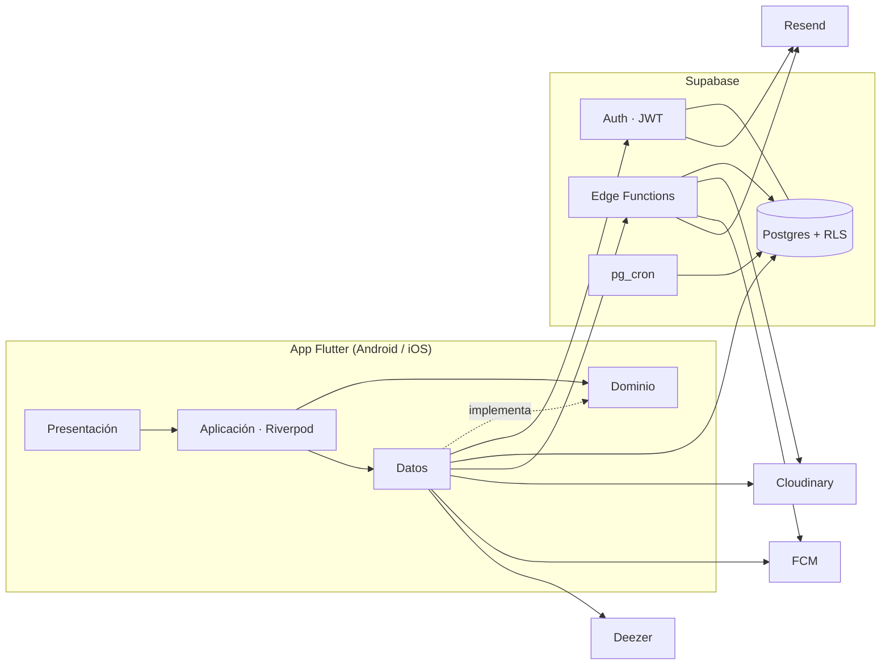
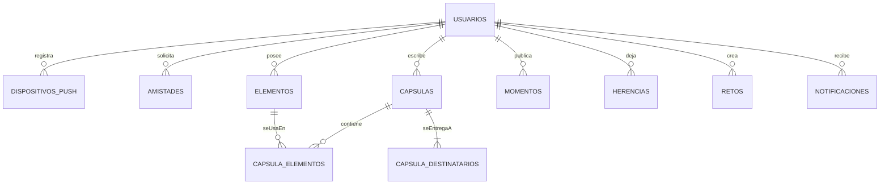

# Capsoul

**Manual Técnico**

Arquitectura, tecnologías, modelo de datos, backend, compilaciones y pruebas

| | |
|---|---|
| **Sistema** | Capsoul: app Flutter (Android e iOS) + Supabase + Cloudinary + FCM |
| **Repositorio** | https://github.com/DeibyRamirez/Capsoul |
| **Paquete** | `com.capsoul` — versión 1.0.0+1 |
| **Equipo** | Deiby Ramírez |
| **Versión del documento** | 1.0 — 1 de noviembre de 2026 |

## Contenido

1. Propósito y alcance
2. Tecnologías y versiones
3. Arquitectura general
4. Arquitectura de la app móvil
5. Patrones de desarrollo
6. Modelo de datos (Postgres / Supabase)
7. Autenticación, RLS y medios
8. Backend (Supabase y Edge Functions)
9. Configuración y ejecución en desarrollo
10. Compilación y artefactos
11. Pruebas
12. Observaciones técnicas y deuda conocida
13. Pendientes de completar

## 1. Propósito y alcance

Este manual describe cómo está construido Capsoul para que otro equipo pueda instalarlo, compilarlo, mantenerlo y extenderlo. Toda la información sale del código y de `docs/` del repositorio. Lo que no está en el código se marca como pendiente.

Capsoul es una aplicación de **cápsulas del tiempo** y **legado digital**. El usuario guarda recuerdos (foto, video, audio, nota, música), los agrupa en momentos, los sella en cápsulas con fecha de apertura y puede dejar herencias a quien ama.

El repositorio no es un monorepo de varios lenguajes: es un proyecto Flutter con el backend en Supabase (SQL y Edge Functions Deno) y documentación en `docs/`.

| Carpeta | Contenido |
|---|---|
| `lib/` | App Flutter: `nucleo/` y `funcionalidades/` |
| `test/` | Espejo de `lib/` más ayudantes |
| `supabase/migrations/` | SQL versionado de Postgres |
| `supabase/functions/` | Edge Functions Deno |
| `docs/` | Arquitectura, modelo ER, flujos, este manual |
| `env/dev.json.example` | Plantilla de `--dart-define-from-file` |
| `.github/workflows/` | CI y build de APK/IPA |

Público: desarrolladores y quien evalúe el trabajo de pasantía. El uso diario de la app está en el [Manual de Usuario](Manual_Usuario_Capsoul.md).

## 2. Tecnologías y versiones

Versiones tomadas de `pubspec.yaml`, el SDK del entorno de desarrollo y los workflows de GitHub Actions.

### 2.1 Aplicación móvil

| Componente | Versión | Uso |
|---|---|---|
| Flutter | canal stable (equipo: 3.47.x) | SDK de la app |
| Dart SDK | ^3.13.2 | Lenguaje |
| `go_router` | ^16.2.0 | Rutas y shell de pestañas |
| `flutter_riverpod` | ^3.4.3 | Estado e inyección |
| `supabase_flutter` | ^2.18.0 | Auth, PostgREST, Functions |
| `firebase_core` | ^4.1.0 | Arranque de FCM |
| `firebase_messaging` | ^16.7.0 | Token y avisos push |
| `camera` | ^0.12.1 | Captura de foto y video |
| `record` | ^7.1.1 | Nota de voz |
| `image_picker` / `file_picker` | ^1.1.2 / ^10.1.2 | Galería y archivos |
| `flutter_image_compress` | ^2.5.1 | Compresión local de fotos |
| `video_player` / `just_audio` | ^2.14.1 / ^0.10.6 | Reproducción |
| `flutter_cache_manager` | ^3.4.5 | Caché de medios en disco |
| `url_launcher` | ^6.3.2 | Abrir Deezer, Spotify, YouTube |
| `flutter_secure_storage` | ^9.2.4 | Almacén cifrado local |
| `mocktail` | ^1.0.5 | Pruebas de repositorios |
| `flutter_lints` | ^6.0.0 | Análisis estático |

Identificador de aplicación: `com.capsoul`. Paquete Dart: `capsoul`.

### 2.2 Backend y servicios

| Componente | Uso |
|---|---|
| Supabase (Auth, Postgres 15+, RLS, RPC, Vault, pg_cron, pg_net) | Cuentas y datos. Plan Free. Proyecto `capsoul`, región us-east-1 |
| Edge Functions (Deno) | `firmar-subida`, `firmar-medio`, `buscar-musica`, `enviar-avisos` |
| Cloudinary | Medios privados, entrega `authenticated` |
| Firebase Cloud Messaging | Solo push (plan Spark). Sin Auth, Firestore ni Storage |
| Resend | SMTP de Auth y correos de aviso |
| Deezer API pública | Búsqueda y preview de 30 s (sin secreto de catálogo) |
| GitHub Actions | CI (`analyze` + `test` + APK debug) y *Build Capsoul* (APK/AAB/IPA) |

La app **nunca** lleva `service_role`, tokens `sb_secret_` ni el `api_secret` de Cloudinary. Solo la URL y la clave **anon/publishable** por `--dart-define-from-file`.

## 3. Arquitectura general

### 3.1 Diagrama (Mermaid)



### 3.2 Diagrama (ASCII)

```
  [Pantallas Flutter]
          |
          v
  [Controladores Riverpod]
          |
          v
  [Repositorios / dominio]
       /        |         \
      v         v          v
 [Supabase] [Cloudinary] [Deezer / FCM]
   Auth+PG     medios      preview / push
```

## 4. Arquitectura de la app móvil

### 4.1 Capas por funcionalidad

No se usa MVVM de Android. Cada área de producto en `lib/funcionalidades/<nombre>/` tiene cuatro carpetas:

| Capa | Carpeta | Responsabilidad |
|---|---|---|
| Presentación | `presentacion/` | Pantallas y componentes. Sin HTTP ni Supabase |
| Aplicación | `aplicacion/` | `Notifier`, proveedores, orquestación |
| Dominio | `dominio/` | Entidades, interfaces `repositorio_*`, fallos |
| Datos | `datos/` | PostgREST, RPC, Cloudinary, Deezer |

Dependencias: `presentacion → aplicacion → dominio ← datos`.

### 4.2 Inyección de dependencias

Riverpod. Los repositorios se exponen con `Provider`; las pruebas los sustituyen con fakes (`mocktail`) vía `ProviderScope.overrides`.

### 4.3 Estructura de paquetes

```
lib/
  main.dart
  app_capsoul.dart
  nucleo/          # enrutador, tema, supabase, firebase, componentes
  funcionalidades/
    autenticacion/  usuarios/  perfil/  inicio/
    recuerdos/  elementos/  musica/  capsulas/
    momentos/  crear/  legado/  retos/
    amistades/  navegacion/
```

### 4.4 Navegación

`go_router` con rutas en español (`/inicio`, `/iniciar-sesion`). `StatefulShellRoute` conserva cuatro pestañas. El `+` no es pestaña: hace `push` a `/crear`. Sin sesión, el router manda a autenticación.

Barra inferior: **Inicio | Momentos | + | Mi legado | Yo**.

### 4.5 Interfaz y sistema de diseño

Material 3, modo claro. Tokens en `ColoresApp` y `TemaApp` (primario `#1B316B`, acento `#3D6B9A`, radios 12–20). Pantallas nuevas usan `PantallaCapsoul` + `FondoCapsoul`. Documentación visual: `docs/Design.md`.

## 5. Patrones de desarrollo usados

- **Repositorio + interfaz** en dominio; implementación en datos.
- **Riverpod** para listas async, formularios y sesión.
- **Fallos de dominio** (`FalloApp` y subclases) con mensaje en español.
- **RLS como fuente de verdad** en el cliente autenticado.
- **Nombres en español** (archivos, clases, tablas). Sin tildes ni ñ en identificadores (`contrasena`).
- **Estados** vacío, cargando y error en listas y detalles.
- **DoD:** `flutter analyze` limpio y `flutter test` en verde.

## 6. Modelo de datos (Postgres / Supabase)

`elementos` es la tabla central: tipo de medio y `cloudinary_public_id`, nunca el binario. Cápsulas, momentos y herencias la enlazan con tablas N:M.



Principios:

1. Nombres en español y `snake_case`.
2. RLS en todas las tablas de negocio.
3. Solo el servidor libera cápsulas y activa herencias (`SECURITY DEFINER` + `pg_cron`).
4. Funciones auxiliares de RLS en el esquema `privado` (no expuesto por PostgREST).
5. En Postgres no se guarda la URL del medio, solo el `public_id`.

El diagrama completo, cardinalidades y supuestos están en [`docs/modelo_er.md`](../modelo_er.md). Las migraciones viven en `supabase/migrations/` (desde `20261002000001` hasta las de amistad y avisos).

## 7. Autenticación, RLS y medios

### 7.1 Auth

Correo y contraseña con **confirmación de correo obligatoria**. El trigger `auth_usuarios_1_crear_perfil` crea la fila en `usuarios`. Un trigger posterior sincroniza el correo si el usuario lo cambia.

### 7.2 RLS

El cliente usa la clave publicable, así que cada política se evalúa con `auth.uid()`. `usuarios` solo se lee completa (con correo) en la fila propia; el resto ve `perfiles_visibles`.

### 7.3 Subida de un medio

```
Usuario captura o elige archivo
        |
        v
App invoca firmar-subida (JWT)
        |
        v
Edge Function devuelve firma + public_id aleatorio
        |
        v
App sube a Cloudinary (type=authenticated)
        |
        v
App inserta metadatos en elementos (RLS)
```

`firmar-medio` entrega URLs temporales solo si `privado.puede_ver_elemento()` lo permite (en cápsulas: liberada y destinatario, o el dueño de su propio medio).

## 8. Backend (Supabase y Edge Functions)

No hay API NestJS. El “backend” es Supabase.

### 8.1 Arquitectura

PostgREST (tablas + RPC) y Edge Functions. Trabajos de servidor: `liberar_capsulas_vencidas()` (cada minuto), `activar_herencias()` (cada hora), `enviar-avisos` (cron). En plan Free, si el proyecto se pausa, el cron no corre.

### 8.2 Seguridad

- App: solo anon key.
- Edge Functions de firma: `api_secret` de Cloudinary como secreto de la función.
- `enviar-avisos`: cabecera de cron, no JWT de usuario.
- `buscar-musica`: JWT; la app actual llama a Deezer en el cliente y no invoca esta función.

### 8.3 Edge Functions

| Función | Rol |
|---|---|
| `firmar-subida` | Firma de subida a Cloudinary, `public_id` aleatorio, derivadas *eager* |
| `firmar-medio` | URLs temporales de original y miniatura |
| `buscar-musica` | Proxy opcional a Deezer (máx. 10 resultados) |
| `enviar-avisos` | Push FCM HTTP v1 y correo Resend |

### 8.4 RPC de producto (ejemplos)

`capsulas_recibidas`, `marcar_capsula_abierta`, `registrar_actividad`, `confirmar_herencia`, `establecer_persona_confianza_legado`, `mis_amigos`, `enviar_solicitud_amistad`.

### 8.5 Despliegue

Proyecto Supabase alojado (us-east-1). Las migraciones y el redespliegue de functions **requieren aprobación del Product Owner**. No se documentan secretos en este manual.

## 9. Configuración y ejecución en desarrollo

### 9.1 Requisitos

Flutter estable, Dart ^3.13, Android Studio o Xcode según la plataforma, un `env/dev.json` con URL y clave anon.

### 9.2 Pasos

1. Clonar el repositorio.
2. Copiar `env/dev.json.example` → `env/dev.json` y pegar la anon key (el archivo está en `.gitignore`).
3. `flutter pub get`
4. `flutter run --dart-define-from-file=env/dev.json`

Para legado, retos o música en un entorno remoto, las migraciones del repo deben estar aplicadas (ver [`docs/migraciones.md`](../migraciones.md)).

### 9.3 Calidad en local

```bash
flutter analyze
flutter test
```

## 10. Compilación y artefactos

### 10.1 CI

`.github/workflows/ci.yml` corre en push a `develop`/`main` y en cada PR: `flutter analyze`, `flutter test` y APK **debug** (sin secretos).

### 10.2 Release (*Build Capsoul*)

`.github/workflows/build.yml` se dispara a mano (`workflow_dispatch`) o en **push a `main`**. Produce APK/AAB de Android (firma de release si hay keystore en secretos; si no, debug) e IPA de iOS **sin firmar**. Los secretos `SUPABASE_URL` y `SUPABASE_ANON_KEY` se inyectan a `env/dev.json` en el runner; no se imprimen.

Compilación local de Android (sin release):

```bash
flutter build apk --debug --dart-define-from-file=env/dev.json
```

## 11. Pruebas

- Widget y unitarias en `test/`, espejo de `lib/`.
- Repositorios falsos en `test/ayudantes/`.
- `MediaQuery.disableAnimations` en el arnés para no colgar `pumpAndSettle`.
- No hay suite E2E de dispositivo en el repo.

## 12. Observaciones técnicas y deuda conocida

- Plan Free de Supabase: riesgo de pausa; `pg_cron` no corre si el proyecto está dormido (decisión aceptada).
- La API pública de Deezer es gratuita para uso no comercial; una publicación comercial en tiendas puede exigir acuerdo con Deezer for Partners.
- El IPA del workflow no va firmado con cuenta de Apple.
- El envío push a iOS queda preparado (APNs) pero el camino productivo actual es Android.
- `buscar-musica` (Edge Function) existe y la app no la llama: busca directo en `api.deezer.com`.

## 13. Pendientes de completar

- Capturas de pantalla oficiales en el manual de usuario (marcadas como `[CAPTURA DE PANTALLA]`).
- URL pública de descarga del APK de tienda, cuando exista.
- Política de privacidad publicada en la ficha de Play / App Store.

---

*Capsoul — Manual Técnico 1.0 — Deiby Ramírez — 1 de noviembre de 2026*
